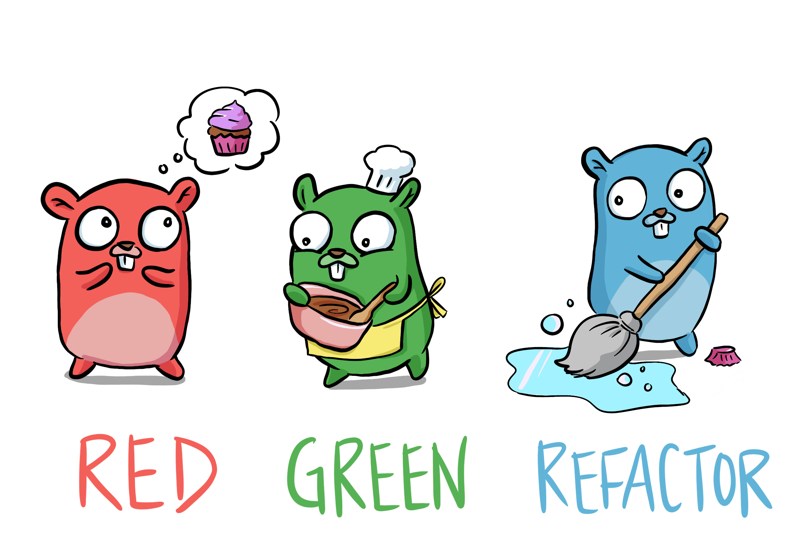

# テスト駆動開発でGo言語を学びましょう

[Art by Denise](https://deniseyu.io/)

## 作者を応援する

このリソースは無料で提供できることを誇りに思っていますが、もし感謝の気持ちを示していただけるなら、

* [Twitter で @quii にツイートする](https://twitter.com/quii)
* [Mastodon](https://mastodon.cloud/@quii)
* [コーヒーをおごる](https://www.buymeacoffee.com/quii)
* [GitHub でスポンサーになる](https://github.com/sponsors/quii)

## Go言語でテスト駆動開発を学ぶ

* テストを書いてGo言語を探求する
* **テスト駆動開発\(TDD\)で基礎を身につけましょう。** GoはTDDを学習するのに適した言語です。なぜなら、学習するのが簡単な言語であり、テストが組み込まれているからです。
* 堅牢で十分にテストされたシステムをGoで書き始めることができるようになることを確信しています。

翻訳:

* [英語（原文）](https://quii.gitbook.io/learn-go-with-tests/)
* [中文](https://studygolang.gitbook.io/learn-go-with-tests)
* [Português](https://larien.gitbook.io/aprenda-go-com-testes/)
* [日本語](https://andmorefine.gitbook.io/learn-go-with-tests/)
* [Français](https://goosegeesejeez.gitbook.io/apprendre-go-par-les-tests)
* [한국어](https://miryang.gitbook.io/learn-go-with-tests/)
* [Türkçe](https://halilkocaoz.gitbook.io/go-programlama-dilini-ogren/)
* [فارسی](https://go-yaad-begir.gitbook.io/go-ba-test/)
* [Nederlands](https://bobkosse.gitbook.io/leer-go-met-tests/)
* [Tiếng Việt](https://sons-organization-15.gitbook.io/learn-go-with-tests)
* [Русский](https://eda-1.gitbook.io/lgwt/)

## 背景

私は、開発チームにGoを導入した経験があり、Goに興味のある人から、Goシステムの非常に効果的なライターへとチームを成長させる方法について、さまざまなアプローチを試してきました。

### うまくいかなかったこと

#### 本を読む

私たちが試したアプローチとして、 [Go Programming Language](https://www.amazon.co.uk/Programming-Language-Addison-Wesley-Professional-Computing/dp/0134190440) を手に取り、毎週次の章を練習問題と一緒に議論することでした。

私はこの本が大好きですが、それには高いレベルのコミットメントが必要です。この本は概念の説明が非常に詳細に書かれていて、それは明らかに素晴らしいことですが、それは進歩がゆっくりと着実に行われていることを意味しています。

少数の人は第X章を読んでエクササイズをしますが、多くの人はそうではありませんでした。

#### 問題を解く

「問題」は楽しいですが、通常は言葉を覚える範囲が限られています。
「問題」を解くためにゴルーチンを使うことはほとんどありません。

もう一つの問題は、熱意のレベルが異なる場合です。ある人は、他の人よりもずっと多くの言語を学んでいるだけで、自分がやったことを実演するときに、他の人がよく知らない特徴で人々を混乱させてしまうことになってしまいます。

これは、学習が非常に構造化されておらず、その場しのぎのものになってしまうことになります。

### 何が効果的だったのか

圧倒的に効果的だったのは、[go by example](https://gobyexample.com/)を読んで、例題で探りながらゆっくりと言語の基礎を紹介し、グループで議論するという方法でした。これは、「宿題のために第X章を読む」よりも、よりインタラクティブなアプローチでした。

時間が経つにつれ、チームは言語の文法の基礎をしっかりと身につけ、システムを構築することができるようになりました。

これは、ギターを習おうとするときに音階を練習するのと似ていると思います。

自分がどれだけ芸術的だと思っていても、基礎を理解し、その仕組みを練習しなければ、良い音楽を書くことはできないでしょう。

### 私には何が合っているのでしょうか？

新しいプログラミング言語を学ぶとき、私は通常`REPL`をいじくりまわして始めますが、最終的にはもっと構造が必要になってきます。

私が好きなのは、コンセプトを探求し、テストでアイデアを固めていくことです。テストは、私が書いたコードが正しいかどうかを検証し、学んだ特徴を文書化します。

グループで学んだ経験と自分なりのやり方で、他のチームの役に立つことを証明できるようなものを作っていきたいと思います。

小さなテストを書くことで基礎を学び、あなたの既存のソフトウェア設計のスキルを活用して、いくつかの素晴らしいシステムを出荷できるようにしたいと思っています。

## 誰のためのものか

* Go言語に興味のある方
* すでにGo言語をある程度知っているが、もっとテストをしてみたい方

## 必要なもの

* パソコン！
* [インストールされたGo](https://golang.org/)
* テキストエディター
* プログラミングの経験。`if`、変数、関数などの概念を理解していること
* ターミナルの使用に慣れている方

## フィードバック

* [こちら](https://github.com/quii/learn-go-with-tests)で issue を追加したり PR を送ったりするか、[Twitter で @quii にツイート](https://twitter.com/quii)してください

[MIT license](LICENSE.md)
