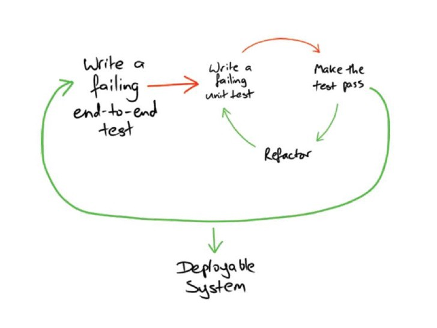
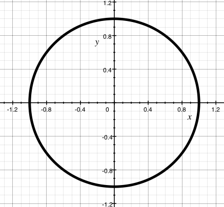
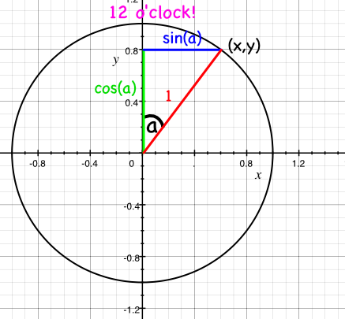
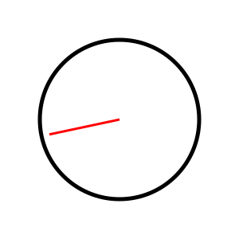

# 数学

[**この章のすべてのコードはここにあります**](https://github.com/quii/learn-go-with-tests/tree/main/math)

現代のコンピューターのすべての能力が驚異的な速さで膨大な合計を実行するために、普通の開発者は自分の仕事を行うために数学を使用することはほとんどありません。

でも今日はだめ！

今日は、数学を使用して実際の問題を解決します。退屈な数学ではありません。
私たちは三角法やベクトルなど、高校の後で使う必要はないと言っていたあらゆる種類のものを使用します。

## 問題

時計のSVGを作成したい。

デジタル時計ではありません。きっと、それは簡単でしょう。アナログ時計です。
あなたが求めているのは、`time`パッケージから`Time`を受け取り、時、分、秒のすべての針が正しい方向を向いている時計の _SVG_ を出力するだけの素敵な関数です。

これがどれほど難しいことなのでしょうか？

最初に、遊ぶために時計の _SVG_ が必要になります。
SVGは、XMLで記述された一連の形状として記述されているため、プログラムで操作するための素晴らしい画像フォーマットです。


このように記述されています。

```xml
<?xml version="1.0" encoding="UTF-8" standalone="no"?>
<!DOCTYPE svg PUBLIC "-//W3C//DTD SVG 1.1//EN" "http://www.w3.org/Graphics/SVG/1.1/DTD/svg11.dtd">
<svg xmlns="http://www.w3.org/2000/svg"
     width="300"
     height="300"
     viewBox="0 0 300 300"
     version="2.0">

  <!-- bezel -->
  <circle cx="150" cy="150" r="100" style="fill:#fff;stroke:#000;stroke-width:5px;"/>

  <!-- hour hand -->
  <line x1="150" y1="150" x2="114.150000" y2="132.260000"
        style="fill:none;stroke:#000;stroke-width:7px;"/>

  <!-- minute hand -->
  <line x1="150" y1="150" x2="101.290000" y2="99.730000"
        style="fill:none;stroke:#000;stroke-width:7px;"/>

  <!-- second hand -->
  <line x1="150" y1="150" x2="77.190000" y2="202.900000"
        style="fill:none;stroke:#f00;stroke-width:3px;"/>
</svg>
```

これは、3本の線が描かれた円で、各線は円の真ん中にあり、（x=150、y=150）あり、少し離れています。

だから私たちがやろうとしていることは、上記をどうにかして再構築することですが、線を変更して、それらが所定の時間に適切な方向を指すようにします。

## 受け入れテスト

行き詰まる前に、受け入れテストについて考えてみましょう。

待って、受け入れテストが何なのかまだ知らないですよね。では、説明してみましょう。

質問させてください。勝利とはどのようなものでしょうか？作業が終わったことはどうすればわかるでしょうか？TDDは、作業が終わったことを知るための良い方法を提供してくれます。テストが成功したときです。ときには（実際にはほとんどの場合）、使用可能な機能全体を書き終えたことを教えてくれるテストを書くと便利です。特定の関数が期待どおりに動作していることを教えてくれるだけのテストではなく、達成しようとしているもの全体、つまり「機能（feature）」が完成したことを教えてくれるテストです。

このようなテストは「受け入れテスト（acceptance tests）」と呼ばれることもあれば、「機能テスト（feature tests）」と呼ばれることもあります。考え方としては、達成しようとしていることを説明する本当に高いレベルのテストを書くということです。たとえば、ユーザーがWebサイトのボタンをクリックすると、捕まえたポケモンの完全なリストが表示される、といったものです。そのテストを書いたら、受け入れテストに合格する動作するシステムに向けて、さらにテスト（ユニットテスト）を書いていくことができます。この例でいえば、それらのテストは、ボタンのあるWebページのレンダリング、Webサーバーのルートハンドラーのテスト、データベースの検索の実行などに関するものになるでしょう。これらはすべてTDDで進められ、そのすべてが元の受け入れテストを成功させることにつながっていきます。

Nat PryceとSteve Freemanによる、この _古典的な_ 図のようなものです。



とにかく、受け入れテスト、つまり完了したときにそれを教えてくれるテストを書いてみましょう。

時計の例があるので、重要なパラメータがどうなるかを考えてみましょう。

```text
<line x1="150" y1="150" x2="114.150000" y2="132.260000"
        style="fill:none;stroke:#000;stroke-width:7px;"/>
```

時計の中心（この線の属性`x1`および`y1`）は、時計の各針で同じです。
時計の針ごとに変更する必要がある数値（SVGを構築するためのパラメーター）は、`x2`および`y2`属性です。時計の針ごとに`X`と`Y`が必要です。

私はより多くのパラメーターについて考えることができました。
文字盤の円の半径、SVGのサイズ、手の色、その形状など...しかし、シンプルで具体的な問題を解決することから始めるのが良いです。具体的な解決策、そしてそれを一般化するためにパラメーターを追加し始めます。

ので、箇条書きにします。

* すべての時計の中心は（150、150）です
* 時針は50です。
* 分針は80です
* 秒針は90です。

SVGに関する注意点：原点（0, 0）-は、予想される _左下_ ではなく、 _左上_ です。どの番号をラインに接続するかを検討しているときは、これを覚えておくことが重要です。

最後に、SVGを構築する _how_ は決めていません。
[`text/template`](https://golang.org/pkg/text/template/)パッケージのテンプレートを使用するか、単にバイトを`bytes.Buffer`またはライターに入れます。しかし、これらの数値が必要になることはわかっているので、それらを作成するもののテストに焦点を合わせましょう。

### 最初にテストを書く

だから私の最初のテストは次のようになります。

```go
package clockface_test

import (
	"projectpath/clockface"
	"testing"
	"time"
)

func TestSecondHandAtMidnight(t *testing.T) {
	tm := time.Date(1337, time.January, 1, 0, 0, 0, 0, time.UTC)

	want := clockface.Point{X: 150, Y: 150 - 90}
	got := clockface.SecondHand(tm)

	if got != want {
		t.Errorf("Got %v, wanted %v", got, want)
	}
}
```

ここでの`projectpath`はプレースホルダーです。自分のモジュールのパスに`/clockface`を加えたものに置き換えてください（たとえば、`go.mod`に`module example.com/learning-go`と書かれていれば、このインポートは`"example.com/learning-go/clockface"`になります）。これが機能するのは、`clockface_test.go`を`clockface`という名前の専用ディレクトリに、（次に作成する）`clockface.go`と並べて置いているからです。ディレクトリ名をその中のパッケージ名と一致させることで、Goはエイリアスなしでインポートを解決できます。同じディレクトリ内の`package clockface_test`は、Goが認めている特別なケースです。同じフォルダ内に`package clockface`のファイルと並んで存在できる外部テストパッケージです。

SVGが左上から座標をプロットする方法を覚えていますか？
秒針を真夜中に配置するには、X軸（まだ150）の文字盤の中心から移動しておらず、Y軸は中心からの「上」方向の長さです。 150 マイナス 90。

### テストを実行してみてください

これにより、不足している関数と型の周囲で予想される失敗が排除されます。

```text
--- FAIL: TestSecondHandAtMidnight (0.00s)
./clockface_test.go:13:10: undefined: clockface.Point
./clockface_test.go:14:9: undefined: clockface.SecondHand
```

だから秒針の先が行くはずの`Point`とそれを取得する関数。

### テストを実行するための最小限のコードを記述し、失敗したテスト出力を確認します

これらの型を実装して、コードをコンパイルしてみましょう

```go
package clockface

import "time"

// A Point represents a two-dimensional Cartesian coordinate
type Point struct {
	X float64
	Y float64
}

// SecondHand is the unit vector of the second hand of an analogue clock at time `t`
// represented as a Point.
func SecondHand(t time.Time) Point {
	return Point{}
}
```

そして今、私たちは

```text
--- FAIL: TestSecondHandAtMidnight (0.00s)
    clockface_test.go:17: Got {0 0}, wanted {150 60}
FAIL
exit status 1
FAIL	learn-go-with-tests/math/clockface	0.006s
```

### 成功させるのに十分なコードを書く

予想される失敗が発生したら、`SecondHand`の戻り値を入力できます。

```go
// SecondHand is the unit vector of the second hand of an analogue clock at time `t`
// represented as a Point.
func SecondHand(t time.Time) Point {
    return Point{150, 60}
}
```

見てください。テストが成功しました。

```text
PASS
ok  	    clockface	0.006s
```

### リファクタリング♪

まだリファクタリングする必要はありません。コードはほとんどありません！

### 新しい要件について繰り返します

毎回真夜中を示す時計を返すだけではなく、おそらくここでいくつかの作業を行う必要があります...

### 最初にテストを書く

```go
func TestSecondHandAt30Seconds(t *testing.T) {
    tm := time.Date(1337, time.January, 1, 0, 0, 30, 0, time.UTC)

    want := clockface.Point{X: 150, Y: 150 + 90}
    got := clockface.SecondHand(tm)

    if got != want {
        t.Errorf("Got %v, wanted %v", got, want)
    }
}
```

同じアイデアですが、今度は秒針が _downwards_ を指しているため、Y軸の長さを _add_ します。

これはコンパイルされます...しかし、どのように成功したのでしょうか？

## 思考時間

この問題をどのように解決しますか？

秒針は毎分同じ60の状態を通過し、60の異なる方向を指しています。 0秒の場合は文字盤の上部を指し、30秒の場合は文字盤の下部を指します。簡単です。

つまり、秒針がどの方向を向いているか、たとえば37秒を考えたい場合は、円の周りの12時から37/60度の間の角度が必要です。
度数では、これは `(360 / 60 ) * 37 = 222`ですが、完全なローテーションの`37/60`であることを覚えているだけの方が簡単です。

しかし、角度はストーリーの半分にすぎません。秒針の先端が指しているX座標とY座標を知る必要があります。どうすればそれを解決できますか？

## 数学

原点の周りに描かれた半径1の円を想像してください。座標`0, 0`。



これは「単位円（`unit circle`）」と呼ばれます。半径が1単位だからです。

円の円周は、グリッド上のポイントから作られます。
より多くの座標。これらの各座標のxおよびyコンポーネントは三角形を形成し、その斜辺は常に1（つまり円の半径）です。


三角測量では、原点との角度がわかっている場合、各三角形のXとYの長さを計算できます。 X座標はcos（a）になり、Y座標はsin（a）になります。ここで、aは線と（positive）x軸とのなす角度です。

.png>)

（これを信じない場合は、[ウィキペディアを見て...](https://en.wikipedia.org/wiki/Sine#Unit_circle_definition)）

最後のひねりX軸からではなく12時からの角度を測定したいので、（3時）、軸を交換する必要があります。ここで、x = sin\(a\)およびy = cos\(a\)です。



これで、秒針の角度（1秒ごとに円の1/60）とX座標とY座標を取得する方法がわかりました。`sin`と` cos`の両方に関数が必要です。

## `math`

幸い、Goの`math`パッケージには両方があり、1つの小さな問題が頭に浮かぶ必要があります。
[`math.Cos`](https://golang.org/pkg/math/#Cos)の説明を見ると

> Cosは、ラジアン引数xの余弦を返します。

角度をラジアンにする必要があります。では、ラジアンとは何ですか？円の完全な回転を360度で構成するのではなく、完全な回転を2πラジアンとして定義します。こうするのには十分な理由がありますが、ここでは立ち入りません。

読んだり、学習したり、考えたりしたので、次のテストを書くことができます。

### 最初にテストを書く

このすべての数学は困難で混乱を招きます。私は何が起こっているのか理解していると確信していません。
それではテストを書きましょう！問題全体を一度に解決する必要はありません。特定の時間の秒針について、ラジアン単位で正しい角度を計算することから始めましょう。

これらのテストに取り組んでいる間は、取り組んでいた受け入れテストを _コメントアウト_ します。これを成功させている間、そのテストに気を取られたくありません。

### パッケージのおさらい

現時点では、受け入れテストは`clockface_test`パッケージにあります。テストは`clockface`パッケージの外にあっても構いません。名前が`_test.go`で終わっていれば実行できます。

これらのラジアンのテストは`clockface`パッケージ _内_ で記述します。それらがエクスポートされることはないかもしれませんし、何が起こっているのかをしっかり把握したら削除される（または移動される）かもしれません。受け入れテストのファイル名を`clockface_acceptance_test.go`に変更し、秒をラジアンでテストするための _新しい_ ファイル`clockface_test`を作成できるようにします。

```go
package clockface

import (
    "math"
    "testing"
    "time"
)

func TestSecondsInRadians(t *testing.T) {
    thirtySeconds := time.Date(312, time.October, 28, 0, 0, 30, 0, time.UTC)
    want := math.Pi
    got := secondsInRadians(thirtySeconds)

    if want != got {
        t.Fatalf("Wanted %v radians, but got %v", want, got)
    }
}
```

ここでは、1分の30秒後に秒針が24時間半になることをテストしています。そして、それは`math`パッケージの最初の使用です！円の1回転が2πラジアンである場合、途中のラウンドはちょうどπラジアンになるはずです。`math.Pi`はπの値を提供します。

### テストを実行してみてください

```text
./clockface_test.go:12:9: undefined: secondsInRadians
```

### テストを実行するための最小限のコードを記述し、失敗したテスト出力を確認します

```go
func secondsInRadians(t time.Time) float64 {
    return 0
}
```

```text
clockface_test.go:15: Wanted 3.141592653589793 radians, but got 0
```

### 成功させるのに十分なコードを書く

```go
func secondsInRadians(t time.Time) float64 {
    return math.Pi
}
```

```text
PASS
ok  	clockface	0.011s
```

### リファクタリング♪

まだリファクタリングは必要ありません。

### 新しい要件について繰り返します

テストを拡張して、さらにいくつかのシナリオをカバーできます。
少し先にスキップして、すでにリファクタリングされたテストコードをいくつか示します。目的の場所に到達する方法は十分に明確になっているはずです。

```go
func TestSecondsInRadians(t *testing.T) {
    cases := []struct {
        time  time.Time
        angle float64
    }{
        {simpleTime(0, 0, 30), math.Pi},
        {simpleTime(0, 0, 0), 0},
        {simpleTime(0, 0, 45), (math.Pi / 2) * 3},
        {simpleTime(0, 0, 7), (math.Pi / 30) * 7},
    }

    for _, c := range cases {
        t.Run(testName(c.time), func(t *testing.T) {
            got := secondsInRadians(c.time)
            if got != c.angle {
                t.Fatalf("Wanted %v radians, but got %v", c.angle, got)
            }
        })
    }
}
```

いくつかのヘルパー関数を追加して、このテーブルベースのテストの作成を少し面倒にしました。 `testName`は時刻をデジタル時計形式（HH：MM：SS）に変換し、`simpleTime`は実際に気にする部分のみを使用して`time.Time`を構築します（再び、時間、分、秒）。これがそのコードです。

```go
func simpleTime(hours, minutes, seconds int) time.Time {
    return time.Date(312, time.October, 28, hours, minutes, seconds, 0, time.UTC)
}

func testName(t time.Time) string {
    return t.Format("15:04:05")
}
```

これらの2つの関数は、これらのテスト（および将来のテ​​スト）の記述と保守を少し簡単にするのに役立ちます。

これにより、優れたテスト出力が得られます。

```text
clockface_test.go:24: Wanted 0 radians, but got 3.141592653589793

clockface_test.go:24: Wanted 4.71238898038469 radians, but got 3.141592653589793
```

上で話していた数学のすべてを実装するお時間です。

```go
func secondsInRadians(t time.Time) float64 {
    return float64(t.Second()) * (math.Pi / 30)
}
```

1秒は（2π/60）ラジアンです... 2をキャンセルすると、π/30ラジアンになります。これに秒数（ `float64`として）を掛けると、すべてのテストに合格するはずです...

```text
clockface_test.go:24: Wanted 3.141592653589793 radians, but got 3.1415926535897936
```

待って、なになに？

### 浮動小数点数（`Floats`）は恐ろしい

浮動小数点演算は[悪名高いほど不正確](https://0.30000000000000004.com/)です。
コンピュータは本当に整数とある程度の有理数しか扱えません。特に、`secondsInRadians`関数のように10進数を上下に因数分解すると、10進数は不正確になり始めます。
`math.Pi`を30で除算してから30を掛けることで、`math.Pi`と同じではない数値になりました。

これを回避するには2つの方法があります。

1. それを受け入れる
2. 方程式をリファクタリングして関数をリファクタリングする

（1）はそれほど魅力的ではないように思われるかもしれませんが、浮動小数点の等価性を機能させる唯一の方法であることがよくあります。時計の文字盤を描画するために、ごくわずかな分数で不正確であることは率直に言って問題にならないので、角度に対して「十分に近い」等式を定義する関数を書くことができます。

しかし、精度を取り戻すには簡単な方法があります。方程式を並べ替えて、分割して乗算しないようにします。分割するだけですべてが可能です。

だから代わりに

```text
numberOfSeconds * π / 30
```

私たちは書けます。

```text
π / (30 / numberOfSeconds)
```

これは同等です。

Goでは次のようになります。

```go
func secondsInRadians(t time.Time) float64 {
    return (math.Pi / (30 / (float64(t.Second()))))
}
```

そして、パスが成功します。

```text
PASS
ok      clockface     0.005s
```

すべて[このようになっている](https://github.com/quii/learn-go-with-tests/tree/main/math/v3/clockface)はずです。

### ゼロ除算についての注意

コンピューターは、無限大が少し奇妙なものであるため、ゼロで割ることを好まないことがよくあります。

Goでは、明示的にゼロで割ろうとするとコンパイルエラーになります。

```go
package main

import (
	"fmt"
)

func main() {
	fmt.Println(10.0 / 0.0) // fails to compile
}
```

もちろん、私たちの`t.Second()`のように、ゼロで割ることになるかどうかをコンパイラーが常に予測できるわけではありません。

これを試してみてください。

```go
func main() {
	fmt.Println(10.0 / zero())
}

func zero() float64 {
	return 0.0
}
```

これは`+Inf`（無限大）を出力します。+Infで割るとゼロになるようです。次のコードで確認できます。

```go
package main

import (
	"fmt"
	"math"
)

func main() {
	fmt.Println(secondsinradians())
}

func zero() float64 {
	return 0.0
}

func secondsinradians() float64 {
	return (math.Pi / (30 / (float64(zero()))))
}
```

### 新しい要件について繰り返します

したがって、ここで最初の部分をカバーしました。
秒針がラジアンで指し示す角度はわかっています。次に、座標を計算する必要があります。

繰り返しますが、これは可能な限り単純にして、_単位円_ でのみ機能するようにします。半径1の円です。これは、手の長さがすべて1であることを意味しますが、明るい面では、数学が飲み込みやすくなります。

### 最初にテストを書く

```go
func TestSecondHandPoint(t *testing.T) {
	cases := []struct {
		time  time.Time
		point Point
	}{
		{simpleTime(0, 0, 30), Point{0, -1}},
	}

	for _, c := range cases {
		t.Run(testName(c.time), func(t *testing.T) {
			got := secondHandPoint(c.time)
			if got != c.point {
				t.Fatalf("Wanted %v Point, but got %v", c.point, got)
			}
		})
	}
}
```

### テストを実行してみてください

```text
./clockface_test.go:40:11: undefined: secondHandPoint
```

### テストを実行するための最小限のコードを記述し、失敗したテスト出力を確認します

```go
func secondHandPoint(t time.Time) Point {
    return Point{}
}
```

```text
clockface_test.go:42: Wanted {0 -1} Point, but got {0 0}
```

### 成功させるのに十分なコードを書く

```go
func secondHandPoint(t time.Time) Point {
    return Point{0, -1}
}
```

```text
PASS
ok  	clockface	0.007s
```

### 新しい要件について繰り返します

```go
func TestSecondHandPoint(t *testing.T) {
    cases := []struct {
        time  time.Time
        point Point
    }{
        {simpleTime(0, 0, 30), Point{0, -1}},
        {simpleTime(0, 0, 45), Point{-1, 0}},
    }

    for _, c := range cases {
        t.Run(testName(c.time), func(t *testing.T) {
            got := secondHandPoint(c.time)
            if got != c.point {
                t.Fatalf("Wanted %v Point, but got %v", c.point, got)
            }
        })
    }
}
```

### テストを実行してみてください

```text
clockface_test.go:43: Wanted {-1 0} Point, but got {0 -1}
```

### 成功させるのに十分なコードを書く

単位円の画像を覚えていますか？

.png>)

また、秒針と3時の間の角度を測るX軸からではなく、Y軸である12時から角度を測りたいことも思い出してください。


ここで、XとYを生成する方程式が必要です。秒に書きましょう。

```go
func secondHandPoint(t time.Time) Point {
    angle := secondsInRadians(t)
    x := math.Sin(angle)
    y := math.Cos(angle)

    return Point{x, y}
}
```

これなら、いけるでしょうか。

```text
clockface_test.go:43: Wanted {0 -1} Point, but got {1.2246467991473515e-16 -1}

clockface_test.go:43: Wanted {-1 0} Point, but got {-1 -1.8369701987210272e-16}
```

待って。。もう一度、フロートにもう一度呪われているようです。
予期しない数値は両方とも、小数点以下16桁で「無限」 _infinitesimal_ のようです。
したがって、ここでも、精度を上げるか、ほぼ同じであると言って私たちの生活を続けるかを選択できます。

これらの角度の精度を向上させる1つのオプションは、`math/big`パッケージの合理的なタイプ`Rat`を使用することです。
しかし、目的が月に着陸することではなくSVGを描画することであることを考えると、少しぼやけていても許容できると思います。

```go
func TestSecondHandPoint(t *testing.T) {
    cases := []struct {
        time  time.Time
        point Point
    }{
        {simpleTime(0, 0, 30), Point{0, -1}},
        {simpleTime(0, 0, 45), Point{-1, 0}},
    }

    for _, c := range cases {
        t.Run(testName(c.time), func(t *testing.T) {
            got := secondHandPoint(c.time)
            if !roughlyEqualPoint(got, c.point) {
                t.Fatalf("Wanted %v Point, but got %v", c.point, got)
            }
        })
    }
}

func roughlyEqualFloat64(a, b float64) bool {
    const equalityThreshold = 1e-7
    return math.Abs(a-b) < equalityThreshold
}

func roughlyEqualPoint(a, b Point) bool {
    return roughlyEqualFloat64(a.X, b.X) &&
        roughlyEqualFloat64(a.Y, b.Y)
}
```

2つの`Points`間のおおよその等価性を定義する2つの関数を定義しました。

* X要素とY要素が互いに0.0000001以内にある場合に機能します。

  それはまだかなり正確です。

そして今、私たちはテストに成功します。

```text
PASS
ok  	clockface	0.007s
```

### リファクタリング♪

これでもかなり満足しています。

[現在はこのようになっています](https://github.com/quii/learn-go-with-tests/tree/main/math/v4/clockface)。

### 新しい要件について繰り返します

まあ、 _new_ と言っても完全に正確というわけではありません。
実際にできることは、受け入れテストに合格することです！それがどのように見えるかを思い出してみましょう

```go
func TestSecondHandAt30Seconds(t *testing.T) {
    tm := time.Date(1337, time.January, 1, 0, 0, 30, 0, time.UTC)

    want := clockface.Point{X: 150, Y: 150 + 90}
    got := clockface.SecondHand(tm)

    if got != want {
        t.Errorf("Got %v, wanted %v", got, want)
    }
}
```

### テストを実行してみてください

```text
clockface_acceptance_test.go:28: Got {150 60}, wanted {150 240}
```

### 成功させるのに十分なコードを書く

単位ベクトルをSVG上の点に変換するには、3つのことを行う必要があります。

1. 針の長さに合わせて拡大縮小します
2. SVGの原点が左上隅にあることを考慮して、X軸で反転します
3. 正しい位置に平行移動します（原点（150, 150）から伸びるようにします）

楽しい時間ですね！

```go
// SecondHand is the unit vector of the second hand of an analogue clock at time `t`
// represented as a Point.
func SecondHand(t time.Time) Point {
    p := secondHandPoint(t)
    p = Point{p.X * 90, p.Y * 90}   // scale
    p = Point{p.X, -p.Y}            // flip
    p = Point{p.X + 150, p.Y + 150} // translate
    return p
}
```

正確にその順序でスケーリング、反転、平行移動します。数学ばんざい！

```text
PASS
ok  	clockface	0.007s
```

### リファクタリング♪

ここに定数として取り出されるべきいくつかの魔法の数字があるので、それをやってみましょう

```go
const secondHandLength = 90
const clockCentreX = 150
const clockCentreY = 150

// SecondHand is the unit vector of the second hand of an analogue clock at time `t`
// represented as a Point.
func SecondHand(t time.Time) Point {
    p := secondHandPoint(t)
    p = Point{p.X * secondHandLength, p.Y * secondHandLength}
    p = Point{p.X, -p.Y}
    p = Point{p.X + clockCentreX, p.Y + clockCentreY} //translate
    return p
}
```

## 時計を描く

さて...とにかく秒針...

これをやってみましょう！
そこに座って人々を魅了するために世界に出て行くのを待っているだけで、価値を提供しないよりも悪いことはありません。秒針を描いてみよう！

メインの`clockface`パッケージディレクトリの下に、（confusingly）、`clockface`という新しいディレクトリを追加します。そこにSVGをビルドするバイナリを作成する`main`パッケージを置きます。

```text
|-- clockface
|       |-- main.go
|-- clockface.go
|-- clockface_acceptance_test.go
|-- clockface_test.go
```

`main.go`の中では、次のコードから始めますが、clockfaceパッケージのインポートは自分のバージョンを指すように変更してください。

```go
package main

import (
	"fmt"
	"io"
	"os"
	"time"

	"learn-go-with-tests/math/clockface" // REPLACE THIS!
)

func main() {
	t := time.Now()
	sh := clockface.SecondHand(t)
	io.WriteString(os.Stdout, svgStart)
	io.WriteString(os.Stdout, bezel)
	io.WriteString(os.Stdout, secondHandTag(sh))
	io.WriteString(os.Stdout, svgEnd)
}

func secondHandTag(p clockface.Point) string {
	return fmt.Sprintf(`<line x1="150" y1="150" x2="%f" y2="%f" style="fill:none;stroke:#f00;stroke-width:3px;"/>`, p.X, p.Y)
}

const svgStart = `<?xml version="1.0" encoding="UTF-8" standalone="no"?>
<!DOCTYPE svg PUBLIC "-//W3C//DTD SVG 1.1//EN" "http://www.w3.org/Graphics/SVG/1.1/DTD/svg11.dtd">
<svg xmlns="http://www.w3.org/2000/svg"
     width="100%"
     height="100%"
     viewBox="0 0 300 300"
     version="2.0">`

const bezel = `<circle cx="150" cy="150" r="100" style="fill:#fff;stroke:#000;stroke-width:5px;"/>`

const svgEnd = `</svg>`
```

ああ、少年よ、私はこの混乱の美しいコードのために賞を獲得しようとしているわけではありません。
しかし、これは仕事をします。これは`os.Stdout`に SVG を書き出しています。一度に一文字ずつ。

これを構築すると

```text
go build
```

そしてそれを実行し、出力をファイルに送信します

```text
./clockface > clock.svg
```

私たちは次のようなものを見るはずです



そして、これが[コードの様子](https://github.com/quii/learn-go-with-tests/tree/main/math/v6/clockface)です。

### リファクタリング♪

これは臭い。まあ、それはまったく悪臭はしませんが、私はそれについて満足していません。

1. その`SecondHand`関数全体は、SVGであることに結びついています...

   SVGについて言及するか、実際にSVGを作成する...

2. ... 同時に、私はSVGコードをテストしていません。

ええ、私は失敗したと思います。これは間違っていると感じます。
よりSVG中心のテストで回復してみましょう。

私たちのオプションは何ですか？
さて、`SVGWriter`から吐き出される文字に、特定の時間に予想されるSVGタグのようなものが含まれていることをテストしてみることができます。例えば：

```go
func TestSVGWriterAtMidnight(t *testing.T) {
    tm := time.Date(1337, time.January, 1, 0, 0, 0, 0, time.UTC)

    var b strings.Builder
    clockface.SVGWriter(&b, tm)
    got := b.String()

    want := `<line x1="150" y1="150" x2="150" y2="60"`

    if !strings.Contains(got, want) {
        t.Errorf("Expected to find the second hand %v, in the SVG output %v", want, got)
    }
}
```

しかし、これは本当に改善されたのでしょうか？

有効なSVGを生成しなかった場合でも（パスが出力に文字列が表示されることをテストするだけなので）成功するだけでなく、その文字列に最小の重要でない変更を加えた場合も失敗します。たとえば、属性の間にスペースを追加します。

_最大の_ においは、データ構造（XML）を一連の文字としての（文字列としての）表示でテストしていることです。これは _never_ 、 _ever_ です。これは、上で概説したのと同じような問題を引き起こすためです。脆弱すぎて感度が不十分なテストです。間違ったことをテストするテスト！

したがって、唯一の解決策は、出力をXMLとしてテストすることです。そのためには、それを解析する必要があります。

## XMLの解析

[`encoding/xml`](https://pkg.go.dev/encoding/xml)は、シンプルなXML解析で行うすべてのことを処理できるGoパッケージです。

関数[`xml.Unmarshal`](https://pkg.go.dev/encoding/xml#Unmarshal)は、XMLデータの`[]byte`と、非整列化する構造体へのポインターを受け取ります。

したがって、XMLを非整列化するための構造体が必要になります。
すべてのノードと属性の正しい名前と正しい構造の書き方を検討するのに少し時間を費やすこともできますが、幸い、誰かがそのハードワークのすべてを自動化してくれるプログラム[`zek`](https://github.com/miku/zek)を書いてくれています。
さらに良いことに、[https://xml-to-go.github.io/](https://xml-to-go.github.io/)にオンラインバージョンがあります。ファイルの上部にあるSVGを1つのボックスに貼り付けるだけです。

* 飛び出します

```go
type Svg struct {
    XMLName xml.Name `xml:"svg"`
    Text    string   `xml:",chardata"`
    Xmlns   string   `xml:"xmlns,attr"`
    Width   string   `xml:"width,attr"`
    Height  string   `xml:"height,attr"`
    ViewBox string   `xml:"viewBox,attr"`
    Version string   `xml:"version,attr"`
    Circle  struct {
        Text  string `xml:",chardata"`
        Cx    string `xml:"cx,attr"`
        Cy    string `xml:"cy,attr"`
        R     string `xml:"r,attr"`
        Style string `xml:"style,attr"`
    } `xml:"circle"`
    Line []struct {
        Text  string `xml:",chardata"`
        X1    string `xml:"x1,attr"`
        Y1    string `xml:"y1,attr"`
        X2    string `xml:"x2,attr"`
        Y2    string `xml:"y2,attr"`
        Style string `xml:"style,attr"`
    } `xml:"line"`
}
```

（構造体の名前を`SVG`に変更するなど）必要がある場合は、これを調整できますが、最初から十分です。この構造体を`clockface_acceptance_test`ファイルに貼り付けて、これを使ったテストを書いてみましょう。

```go
func TestSVGWriterAtMidnight(t *testing.T) {
    tm := time.Date(1337, time.January, 1, 0, 0, 0, 0, time.UTC)

    b := bytes.Buffer{}
    clockface.SVGWriter(&b, tm)

    svg := Svg{}
    xml.Unmarshal(b.Bytes(), &svg)

    x2 := "150"
    y2 := "60"

    for _, line := range svg.Line {
        if line.X2 == x2 && line.Y2 == y2 {
            return
        }
    }

    t.Errorf("Expected to find the second hand with x2 of %+v and y2 of %+v, in the SVG output %v", x2, y2, b.String())
}
```

`clockface.SVGWriter`の出力を`bytes.Buffer`に書き込み、次にそれを`Svg`に`Unmarshal`します。次に、`Svg`内の各`Line`を見て、それらのいずれかが期待される`X2`および`Y2`値を持っているかどうかを確認します。
一致した場合、早期に（テストに合格）します。そうでない場合、（うまくいけば）情報メッセージで失敗します。

```sh
./clockface_acceptance_test.go:41:2: undefined: clockface.SVGWriter
```

`SVGWriter.go`を作成したほうがよさそうです...

```go
package clockface

import (
    "fmt"
    "io"
    "time"
)

const (
    secondHandLength = 90
    clockCentreX     = 150
    clockCentreY     = 150
)

//SVGWriter writes an SVG representation of an analogue clock, showing the time t, to the writer w
func SVGWriter(w io.Writer, t time.Time) {
    io.WriteString(w, svgStart)
    io.WriteString(w, bezel)
    secondHand(w, t)
    io.WriteString(w, svgEnd)
}

func secondHand(w io.Writer, t time.Time) {
    p := secondHandPoint(t)
    p = Point{p.X * secondHandLength, p.Y * secondHandLength} // scale
    p = Point{p.X, -p.Y}                                      // flip
    p = Point{p.X + clockCentreX, p.Y + clockCentreY}         // translate
    fmt.Fprintf(w, `<line x1="150" y1="150" x2="%f" y2="%f" style="fill:none;stroke:#f00;stroke-width:3px;"/>`, p.X, p.Y)
}

const svgStart = `<?xml version="1.0" encoding="UTF-8" standalone="no"?>
<!DOCTYPE svg PUBLIC "-//W3C//DTD SVG 1.1//EN" "http://www.w3.org/Graphics/SVG/1.1/DTD/svg11.dtd">
<svg xmlns="http://www.w3.org/2000/svg"
     width="100%"
     height="100%"
     viewBox="0 0 300 300"
     version="2.0">`

const bezel = `<circle cx="150" cy="150" r="100" style="fill:#fff;stroke:#000;stroke-width:5px;"/>`

const svgEnd = `</svg>`
```

最も美しいSVGの書き方ですか？いいえ。でもうまくいけば、うまくいきます...

```text
clockface_acceptance_test.go:56: Expected to find the second hand with x2 of 150 and y2 of 60, in the SVG output <?xml version="1.0" encoding="UTF-8" standalone="no"?>
    <!DOCTYPE svg PUBLIC "-//W3C//DTD SVG 1.1//EN" "http://www.w3.org/Graphics/SVG/1.1/DTD/svg11.dtd">
    <svg xmlns="http://www.w3.org/2000/svg"
         width="100%"
         height="100%"
         viewBox="0 0 300 300"
         version="2.0"><circle cx="150" cy="150" r="100" style="fill:#fff;stroke:#000;stroke-width:5px;"/><line x1="150" y1="150" x2="150.000000" y2="60.000000" style="fill:none;stroke:#f00;stroke-width:3px;"/></svg>
```

おっと！

`％f`フォーマットディレクティブは、座標をデフォルトの精度レベル（小数点以下6桁）に出力します。座標に期待する精度のレベルを明示する必要があります。小数点第3位としましょう。

```go
	fmt.Fprintf(w, `<line x1="150" y1="150" x2="%.3f" y2="%.3f" style="fill:none;stroke:#f00;stroke-width:3px;"/>`, p.X, p.Y)
```

テストでの期待を更新した後

```go
    x2 := "150.000"
    y2 := "60.000"
```

我々はテストの成功を得られます

```text
PASS
ok  	clockface	0.006s
```

`main`関数を短くすることができます。

```go
package main

import (
	"os"
	"time"

	"learn-go-with-tests/math/clockface"
)

func main() {
	t := time.Now()
	clockface.SVGWriter(os.Stdout, t)
}
```

[現在はこのようになっている](https://github.com/quii/learn-go-with-tests/tree/main/math/v7b/clockface)はずです。

そして、同じパターンに従って別の時間のテストを書くことができますが、その前に...

### リファクタリング♪

3つのことが突き出ています。

1. 存在を確認する必要がある情報のすべてを実際にテストしているわけではありません。たとえば、`x1`の値はどうでしょうか？
2. また、`x1`などの属性は実際には`strings`ではありませんよね？数値です！
3. 針の`style`を本当に気にしていますか？あるいは、`zak`によって生成された空の`Text`ノードはどうでしょうか？

私たちはもっとうまくやることができます。
すべてをシャープにするために、`Svg`構造体とテストにいくつかの調整を加えましょう。

```go
type SVG struct {
    XMLName xml.Name `xml:"svg"`
    Xmlns   string   `xml:"xmlns,attr"`
    Width   string   `xml:"width,attr"`
    Height  string   `xml:"height,attr"`
    ViewBox string   `xml:"viewBox,attr"`
    Version string   `xml:"version,attr"`
    Circle  Circle   `xml:"circle"`
    Line    []Line   `xml:"line"`
}

type Circle struct {
    Cx float64 `xml:"cx,attr"`
    Cy float64 `xml:"cy,attr"`
    R  float64 `xml:"r,attr"`
}

type Line struct {
    X1 float64 `xml:"x1,attr"`
    Y1 float64 `xml:"y1,attr"`
    X2 float64 `xml:"x2,attr"`
    Y2 float64 `xml:"y2,attr"`
}
```

ここで私は

* 構造体の重要な部分を名前付きの型にしました -- `Line` と `Circle`

* 数値属性を`string`ではなく`float64`に変更しました。
* `Style`や` Text`などの未使用の属性を削除
* `Svg`を`SVG`に名前を変更しました。 _それが正しいことだからです_ 。

これにより、探している行でより正確に評価できます。

```go
func TestSVGWriterAtMidnight(t *testing.T) {
    tm := time.Date(1337, time.January, 1, 0, 0, 0, 0, time.UTC)
    b := bytes.Buffer{}

    clockface.SVGWriter(&b, tm)

    svg := SVG{}

    xml.Unmarshal(b.Bytes(), &svg)

    want := Line{150, 150, 150, 60}

    for _, line := range svg.Line {
        if line == want {
            return
        }
    }

    t.Errorf("Expected to find the second hand line %+v, in the SVG lines %+v", want, svg.Line)
}
```

最後に、単体テストのテーブルを参考にして、ヘルパー関数`containsLine(line Line, lines []Line) bool`を記述して、これらのテストを本当に輝かせることができます。`simpleTime`と`testName`も再び使いますが、このファイル（`clockface_acceptance_test.go`）は`package clockface_test`にあり、それらを最初に書いた`clockface_test.go`ファイル（`package clockface`）とは別のパッケージです。これらはエクスポートされていないため、宣言されたパッケージの外からは見えません。そのため、ここに独自のコピーが必要です。

```go
func TestSVGWriterSecondHand(t *testing.T) {
	cases := []struct {
		time time.Time
		line Line
	}{
		{
			simpleTime(0, 0, 0),
			Line{150, 150, 150, 60},
		},
		{
			simpleTime(0, 0, 30),
			Line{150, 150, 150, 240},
		},
	}

	for _, c := range cases {
		t.Run(testName(c.time), func(t *testing.T) {
			b := bytes.Buffer{}
			clockface.SVGWriter(&b, c.time)

			svg := SVG{}
			xml.Unmarshal(b.Bytes(), &svg)

			if !containsLine(c.line, svg.Line) {
				t.Errorf("Expected to find the second hand line %+v, in the SVG lines %+v", c.line, svg.Line)
			}
		})
	}
}

func containsLine(l Line, ls []Line) bool {
	for _, line := range ls {
		if line == l {
			return true
		}
	}
	return false
}

func simpleTime(hours, minutes, seconds int) time.Time {
	return time.Date(312, time.October, 28, hours, minutes, seconds, 0, time.UTC)
}

func testName(t time.Time) string {
	return t.Format("15:04:05")
}
```

[このようになります](https://github.com/quii/learn-go-with-tests/tree/main/math/v7c/clockface)。

さて、 _これこそ_ 私が受け入れテストと呼ぶものです！

### 最初にテストを書く

これが秒針です。それでは分針から始めましょう。

```go
func TestSVGWriterMinuteHand(t *testing.T) {
	cases := []struct {
		time time.Time
		line Line
	}{
		{
			simpleTime(0, 0, 0),
			Line{150, 150, 150, 70},
		},
	}

	for _, c := range cases {
		t.Run(testName(c.time), func(t *testing.T) {
			b := bytes.Buffer{}
			clockface.SVGWriter(&b, c.time)

			svg := SVG{}
			xml.Unmarshal(b.Bytes(), &svg)

			if !containsLine(c.line, svg.Line) {
				t.Errorf("Expected to find the minute hand line %+v, in the SVG lines %+v", c.line, svg.Line)
			}
		})
	}
}
```

### テストを実行してみてください

```text
clockface_acceptance_test.go:87: Expected to find the minute hand line {X1:150 Y1:150 X2:150 Y2:70}, in the SVG lines [{X1:150 Y1:150 X2:150 Y2:60}]
```

他の時計針の作成を開始した方がよいでしょう。
秒針のテストを作成したのと同じように、反復して次の一連のテストを作成できます。再び、これが機能している間、受け入れテストをコメントアウトします。

```go
func TestMinutesInRadians(t *testing.T) {
    cases := []struct {
        time  time.Time
        angle float64
    }{
        {simpleTime(0, 30, 0), math.Pi},
    }

    for _, c := range cases {
        t.Run(testName(c.time), func(t *testing.T) {
            got := minutesInRadians(c.time)
            if got != c.angle {
                t.Fatalf("Wanted %v radians, but got %v", c.angle, got)
            }
        })
    }
}
```

### テストを実行してみてください

```text
./clockface_test.go:59:11: undefined: minutesInRadians
```

### テストを実行するための最小限のコードを記述し、失敗したテスト出力を確認します

```go
func minutesInRadians(t time.Time) float64 {
    return math.Pi
}
```

### 新しい要件について繰り返します

さて、OKです。
では、自分自身でいくつかの実際の作業をさせましょう。
私たちは分針を1分おきにのみ移動するようにモデル化することができます。
そのため、30分から31分後に移動せずに「ジャンプ」します。しかし、それは少しゴミに見えるでしょう。私たちがしたいことは、毎秒少しずつ移動することです。

```go
func TestMinutesInRadians(t *testing.T) {
    cases := []struct {
        time  time.Time
        angle float64
    }{
        {simpleTime(0, 30, 0), math.Pi},
        {simpleTime(0, 0, 7), 7 * (math.Pi / (30 * 60))},
    }

    for _, c := range cases {
        t.Run(testName(c.time), func(t *testing.T) {
            got := minutesInRadians(c.time)
            if got != c.angle {
                t.Fatalf("Wanted %v radians, but got %v", c.angle, got)
            }
        })
    }
}
```

その小さな少しはいくらですか？お上手...

* 1分で60秒
* 円の半回転で30分（`math.Pi`ラジアン）
* 半回転で`30*60`秒。
* したがって、時刻が1時間の7秒後であれば...
* 分針が「`7 * (math.Pi / (30 * 60))`」に表示されることを期待しています

  12を過ぎたラジアン

### テストを実行してみてください

```
clockface_test.go:62: Wanted 0.012217304763960306 radians, but got 3.141592653589793
```

### 成功させるのに十分なコードを書く

ジェニファーアニストンの不滅の言葉: [科学のビットがここに来る](https://www.youtube.com/watch?v=29Im23SPNok)

```go
func minutesInRadians(t time.Time) float64 {
    return (secondsInRadians(t) / 60) +
        (math.Pi / (30 / float64(t.Minute())))
}
```

ここでは、1秒ごとに時計の針の周りに分針をどれだけ押し込むかを考えるのではなく、`secondsInRadians`関数を利用できます。
1秒ごとに、分針が秒針の角度の1/60ずつ移動します。

```go
secondsInRadians(t) / 60
```

次に、秒針の動きと同様に、分の動きを追加します。

```go
math.Pi / (30 / float64(t.Minute()))
```

そして...

```
PASS
ok  	clockface	0.007s
```

簡単です。[現在はこのようになっています](https://github.com/quii/learn-go-with-tests/tree/main/math/v8/clockface/clockface_acceptance_test.go)。

### 新しい要件について繰り返します

`minutesInRadians`テストにさらにケースを追加する必要がありますか？現時点では2つしかありません。`minuteHandPoint`関数のテストに進む前に、いくつのケースが必要ですか？

私のお気に入りのTDDの引用の1つは、しばしばケント・ベックの言葉とされている次のものです。

> 恐怖が退屈に変わるまでテストを書いてください。

そして、率直に言って、私はその機能をテストすることに飽き飽きしています。私はそれがどのように機能するかを知っていると確信しています。次の問題です。

### 最初にテストを書く

```go
func TestMinuteHandPoint(t *testing.T) {
    cases := []struct {
        time  time.Time
        point Point
    }{
        {simpleTime(0, 30, 0), Point{0, -1}},
    }

    for _, c := range cases {
        t.Run(testName(c.time), func(t *testing.T) {
            got := minuteHandPoint(c.time)
            if !roughlyEqualPoint(got, c.point) {
                t.Fatalf("Wanted %v Point, but got %v", c.point, got)
            }
        })
    }
}
```

### テストを実行してみてください

```text
./clockface_test.go:79:11: undefined: minuteHandPoint
```

### テストを実行するための最小限のコードを記述し、失敗したテスト出力を確認します

```go
func minuteHandPoint(t time.Time) Point {
    return Point{}
}
```

```text
clockface_test.go:80: Wanted {0 -1} Point, but got {0 0}
```

### 成功させるのに十分なコードを書く

```go
func minuteHandPoint(t time.Time) Point {
    return Point{0, -1}
}
```

```text
PASS
ok  	clockface	0.007s
```

### 新しい要件について繰り返します

そして今、実際の仕事のために

```go
func TestMinuteHandPoint(t *testing.T) {
    cases := []struct {
        time  time.Time
        point Point
    }{
        {simpleTime(0, 30, 0), Point{0, -1}},
        {simpleTime(0, 45, 0), Point{-1, 0}},
    }

    for _, c := range cases {
        t.Run(testName(c.time), func(t *testing.T) {
            got := minuteHandPoint(c.time)
            if !roughlyEqualPoint(got, c.point) {
                t.Fatalf("Wanted %v Point, but got %v", c.point, got)
            }
        })
    }
}
```

```text
clockface_test.go:81: Wanted {-1 0} Point, but got {0 -1}
```

### 成功させるのに十分なコードを書く

いくつかの小さな変更を加えた`secondHandPoint`関数の簡単なコピーと貼り付けは、それを行うべきです...

```go
func minuteHandPoint(t time.Time) Point {
    angle := minutesInRadians(t)
    x := math.Sin(angle)
    y := math.Cos(angle)

    return Point{x, y}
}
```

```text
PASS
ok  	clockface	0.009s
```

### リファクタリング♪

`minuteHandPoint`と` secondHandPoint`には間違いなく少し繰り返しがあります。一方をコピーして貼り付け、もう一方を作成したためです。関数で乾かしてみましょう。

```go
func angleToPoint(angle float64) Point {
    x := math.Sin(angle)
    y := math.Cos(angle)

    return Point{x, y}
}
```

また、`minuteHandPoint`と`secondHandPoint`をワンライナーとして書き換えることもできます。

```go
func minuteHandPoint(t time.Time) Point {
    return angleToPoint(minutesInRadians(t))
}
```

```go
func secondHandPoint(t time.Time) Point {
    return angleToPoint(secondsInRadians(t))
}
```

```text
PASS
ok  	clockface	0.007s
```

これで、受け入れテストのコメントを外して、分針を描き始めることができます。

### 成功させるのに十分なコードを書く

`minuteHand`関数は、`minuteHandLength`を宣言するなどの小さな調整を加えた`secondHand`のコピー＆ペーストです。

```go
const minuteHandLength = 80

//...

func minuteHand(w io.Writer, t time.Time) {
	p := minuteHandPoint(t)
	p = Point{p.X * minuteHandLength, p.Y * minuteHandLength}
	p = Point{p.X, -p.Y}
	p = Point{p.X + clockCentreX, p.Y + clockCentreY}
	fmt.Fprintf(w, `<line x1="150" y1="150" x2="%.3f" y2="%.3f" style="fill:none;stroke:#000;stroke-width:3px;"/>`, p.X, p.Y)
}
```

そして、`SVGWriter`関数の中でそれを呼び出します。

```go
func SVGWriter(w io.Writer, t time.Time) {
	io.WriteString(w, svgStart)
	io.WriteString(w, bezel)
	secondHand(w, t)
	minuteHand(w, t)
	io.WriteString(w, svgEnd)
}
```

これで`TestSVGWriterMinuteHand`が成功するはずです。

```text
PASS
ok  	clockface	0.006s
```

しかし、論より証拠です。ここで`clockface`プログラムをコンパイルして実行すると、以下のようなものが表示されるはずです。

.svg>)

### リファクタリング♪

`secondHand`関数と`minuteHand`関数から重複を取り除き、そのすべてのスケール、フリップ、および変換をすべて1つの場所に配置します。

```go
func secondHand(w io.Writer, t time.Time) {
    p := makeHand(secondHandPoint(t), secondHandLength)
    fmt.Fprintf(w, `<line x1="150" y1="150" x2="%.3f" y2="%.3f" style="fill:none;stroke:#f00;stroke-width:3px;"/>`, p.X, p.Y)
}

func minuteHand(w io.Writer, t time.Time) {
    p := makeHand(minuteHandPoint(t), minuteHandLength)
    fmt.Fprintf(w, `<line x1="150" y1="150" x2="%.3f" y2="%.3f" style="fill:none;stroke:#000;stroke-width:3px;"/>`, p.X, p.Y)
}

func makeHand(p Point, length float64) Point {
    p = Point{p.X * length, p.Y * length}
    p = Point{p.X, -p.Y}
    return Point{p.X + clockCentreX, p.Y + clockCentreY}
}
```

```text
PASS
ok  	clockface	0.007s
```

[現在はここまで来ています](https://github.com/quii/learn-go-with-tests/tree/main/math/v9/clockface)。

さあ...あとは時針だけです！

### 最初にテストを書く

```go
func TestSVGWriterHourHand(t *testing.T) {
    cases := []struct {
        time time.Time
        line Line
    }{
        {
            simpleTime(6, 0, 0),
            Line{150, 150, 150, 200},
        },
    }

    for _, c := range cases {
        t.Run(testName(c.time), func(t *testing.T) {
            b := bytes.Buffer{}
            clockface.SVGWriter(&b, c.time)

            svg := SVG{}
            xml.Unmarshal(b.Bytes(), &svg)

            if !containsLine(c.line, svg.Line) {
                t.Errorf("Expected to find the hour hand line %+v, in the SVG lines %+v", c.line, svg.Line)
            }
        })
    }
}
```

### テストを実行してみてください

```text
clockface_acceptance_test.go:113: Expected to find the hour hand line {X1:150 Y1:150 X2:150 Y2:200}, in the SVG lines [{X1:150 Y1:150 X2:150 Y2:60} {X1:150 Y1:150 X2:150 Y2:70}]
```

繰り返しますが、下位レベルのテストでいくつかのカバレッジが得られるまで、これをコメントアウトしてみましょう。

### 最初にテストを書く

```go
func TestHoursInRadians(t *testing.T) {
    cases := []struct {
        time  time.Time
        angle float64
    }{
        {simpleTime(6, 0, 0), math.Pi},
    }

    for _, c := range cases {
        t.Run(testName(c.time), func(t *testing.T) {
            got := hoursInRadians(c.time)
            if got != c.angle {
                t.Fatalf("Wanted %v radians, but got %v", c.angle, got)
            }
        })
    }
}
```

### テストを実行してみてください

```text
./clockface_test.go:97:11: undefined: hoursInRadians
```

### テストを実行するための最小限のコードを記述し、失敗したテスト出力を確認します

```go
func hoursInRadians(t time.Time) float64 {
    return math.Pi
}
```

```text
PASS
ok  	clockface	0.007s
```

### 新しい要件について繰り返します

```go
func TestHoursInRadians(t *testing.T) {
    cases := []struct {
        time  time.Time
        angle float64
    }{
        {simpleTime(6, 0, 0), math.Pi},
        {simpleTime(0, 0, 0), 0},
    }

    for _, c := range cases {
        t.Run(testName(c.time), func(t *testing.T) {
            got := hoursInRadians(c.time)
            if got != c.angle {
                t.Fatalf("Wanted %v radians, but got %v", c.angle, got)
            }
        })
    }
}
```

### テストを実行してみてください

```text
clockface_test.go:100: Wanted 0 radians, but got 3.141592653589793
```

### 成功させるのに十分なコードを書く

```go
func hoursInRadians(t time.Time) float64 {
    return (math.Pi / (6 / float64(t.Hour())))
}
```

### 新しい要件について繰り返します

```go
func TestHoursInRadians(t *testing.T) {
    cases := []struct {
        time  time.Time
        angle float64
    }{
        {simpleTime(6, 0, 0), math.Pi},
        {simpleTime(0, 0, 0), 0},
        {simpleTime(21, 0, 0), math.Pi * 1.5},
    }

    for _, c := range cases {
        t.Run(testName(c.time), func(t *testing.T) {
            got := hoursInRadians(c.time)
            if got != c.angle {
                t.Fatalf("Wanted %v radians, but got %v", c.angle, got)
            }
        })
    }
}
```

### テストを実行してみてください

```text
clockface_test.go:101: Wanted 4.71238898038469 radians, but got 10.995574287564276
```

### 成功させるのに十分なコードを書く

```go
func hoursInRadians(t time.Time) float64 {
    return (math.Pi / (6 / (float64(t.Hour() % 12))))
}
```

これは24時間時計ではないことに注意してください。残りの演算子を使用して、現在の時間の残りを12で除算する必要があります。

```text
PASS
ok  	learn-go-with-tests/math/clockface	0.008s
```

### 最初にテストを書く

次に、経過した分と秒に基づいて、時針を文字盤の周りで動かしてみましょう。

```go
func TestHoursInRadians(t *testing.T) {
    cases := []struct {
        time  time.Time
        angle float64
    }{
        {simpleTime(6, 0, 0), math.Pi},
        {simpleTime(0, 0, 0), 0},
        {simpleTime(21, 0, 0), math.Pi * 1.5},
        {simpleTime(0, 1, 30), math.Pi / ((6 * 60 * 60) / 90)},
    }

    for _, c := range cases {
        t.Run(testName(c.time), func(t *testing.T) {
            got := hoursInRadians(c.time)
            if got != c.angle {
                t.Fatalf("Wanted %v radians, but got %v", c.angle, got)
            }
        })
    }
}
```

### テストを実行してみてください

```text
clockface_test.go:102: Wanted 0.013089969389957472 radians, but got 0
```

### 成功させるのに十分なコードを書く

繰り返しになりますが、今は少し考える必要があります。分と秒の両方で、時針を少し沿って動かす必要があります。幸いにも、分と秒のためにすでに角度を持っています。`minutesInRadians`によって返される角度です。再利用できます！

したがって、唯一の問題は、その角度のサイズを小さくするための要因です。 1回転は分針の場合は1時間ですが、時針の場合は12時間です。したがって、`minutesInRadians`によって返される角度を12で割ります。

```go
func hoursInRadians(t time.Time) float64 {
    return (minutesInRadians(t) / 12) +
        (math.Pi / (6 / float64(t.Hour()%12)))
}
```

見よ

```text
clockface_test.go:104: Wanted 0.013089969389957472 radians, but got 0.01308996938995747
```

浮動小数点演算がまたやってくれました。

角度の比較に`roughlyEqualFloat64`を使用するようにテストを更新してみましょう。

```go
func TestHoursInRadians(t *testing.T) {
    cases := []struct {
        time  time.Time
        angle float64
    }{
        {simpleTime(6, 0, 0), math.Pi},
        {simpleTime(0, 0, 0), 0},
        {simpleTime(21, 0, 0), math.Pi * 1.5},
        {simpleTime(0, 1, 30), math.Pi / ((6 * 60 * 60) / 90)},
    }

    for _, c := range cases {
        t.Run(testName(c.time), func(t *testing.T) {
            got := hoursInRadians(c.time)
            if !roughlyEqualFloat64(got, c.angle) {
                t.Fatalf("Wanted %v radians, but got %v", c.angle, got)
            }
        })
    }
}
```

```text
PASS
ok  	clockface	0.007s
```

### リファクタリング♪

ラジアンテストの _one_ で`roughlyEqualFloat64`を使用する場合、それらの _all_ に使用する必要があります。それは素晴らしくて単純なリファクタリングで、[このような状態](https://github.com/quii/learn-go-with-tests/tree/main/math/v10/clockface)になります。

## 時針

さて、今度は、単位ベクトルを計算して、時針の位置を計算します。

### 最初にテストを書く

```go
func TestHourHandPoint(t *testing.T) {
    cases := []struct {
        time  time.Time
        point Point
    }{
        {simpleTime(6, 0, 0), Point{0, -1}},
        {simpleTime(21, 0, 0), Point{-1, 0}},
    }

    for _, c := range cases {
        t.Run(testName(c.time), func(t *testing.T) {
            got := hourHandPoint(c.time)
            if !roughlyEqualPoint(got, c.point) {
                t.Fatalf("Wanted %v Point, but got %v", c.point, got)
            }
        })
    }
}
```

待って、私は _2つ_ のテストケースを _一度に_ 書くのですか？これは _悪いTDD_ ではありませんか？

### TDD熱狂について

テスト駆動開発は宗教ではありません。一部の人々はそのように振る舞うかもしれません。
たいていは、TDDを実践していないのに、TDDは熱狂者だけがやるものだ、自分たちがテストを書かないのは「実用的」だからだ、とTwitterやDev.toで喜んで不満を言う人々です。しかしそれは宗教ではありません。それはツールです。

私は2つのテストがどうなるかを _知っています_ 。他の2つの時計の針をまったく同じ方法でテストしました。そして、実装がどうなるかもすでに知っています。分針のイテレーションで、角度を点に変換する一般的なケースの関数を書いたからです。

形式のためだけにTDDの儀式をこなすつもりはありません。TDDは、自分が書いているコード、そしてこれから書こうとしているコードをよりよく理解するのに役立つテクニックです。TDDはフィードバック、知識、洞察を与えてくれます。しかし、すでにその知識を持っているのであれば、理由もなく儀式をこなすつもりはありません。テストもTDDもそれ自体が目的ではありません。

自信がついたので、大きく前進できると思います。私はいくつかのステップを「スキップ」します。なぜなら、自分がどこにいるのか、どこに行くのか、そして以前にこの道を歩いたことがあるからです。

しかし、また注意してください。
私はテストを書くことを完全にスキップしているわけではありません。今でもテストを最初に書いています。ただ、より粒度の粗い単位で登場しているだけです。

### テストを実行してみてください

```text
./clockface_test.go:119:11: undefined: hourHandPoint
```

### 成功させるのに十分なコードを書く

```go
func hourHandPoint(t time.Time) Point {
    return angleToPoint(hoursInRadians(t))
}
```

私が言ったように、私は自分がどこにいるのか、そしてどこに行くのかを知っています。
なぜ他のふりをするのですか？テストは私が間違っているかどうかすぐに教えてくれます。

```text
PASS
ok  	learn-go-with-tests/math/clockface	0.009s
```

## 時針を引きます

そして最後に、時針で描画します。コメントを外すことで、受け入れテストを導入できます。

```go
func TestSVGWriterHourHand(t *testing.T) {
    cases := []struct {
        time time.Time
        line Line
    }{
        {
            simpleTime(6, 0, 0),
            Line{150, 150, 150, 200},
        },
    }

    for _, c := range cases {
        t.Run(testName(c.time), func(t *testing.T) {
            b := bytes.Buffer{}
            clockface.SVGWriter(&b, c.time)

            svg := SVG{}
            xml.Unmarshal(b.Bytes(), &svg)

            if !containsLine(c.line, svg.Line) {
                t.Errorf("Expected to find the hour hand line %+v, in the SVG lines %+v", c.line, svg.Line)
            }
        })
    }
}
```

### テストを実行してみてください

```text
clockface_acceptance_test.go:113: Expected to find the hour hand line {X1:150 Y1:150 X2:150 Y2:200},
    in the SVG lines [{X1:150 Y1:150 X2:150 Y2:60} {X1:150 Y1:150 X2:150 Y2:70}]
```

### 成功させるのに十分なコードを書く

そして、SVGを書き出す定数と関数に最終調整を加えることができます。

```go
const (
    secondHandLength = 90
    minuteHandLength = 80
    hourHandLength   = 50
    clockCentreX     = 150
    clockCentreY     = 150
)

//SVGWriter writes an SVG representation of an analogue clock, showing the time t, to the writer w
func SVGWriter(w io.Writer, t time.Time) {
    io.WriteString(w, svgStart)
    io.WriteString(w, bezel)
    secondHand(w, t)
    minuteHand(w, t)
    hourHand(w, t)
    io.WriteString(w, svgEnd)
}

// ...

func hourHand(w io.Writer, t time.Time) {
    p := makeHand(hourHandPoint(t), hourHandLength)
    fmt.Fprintf(w, `<line x1="150" y1="150" x2="%.3f" y2="%.3f" style="fill:none;stroke:#000;stroke-width:3px;"/>`, p.X, p.Y)
}
```

など...

```text
ok  	clockface	0.007s
```

`clockface`プログラムをコンパイルして実行して確認してみましょう。

.svg>)

### リファクタリング♪

`clockface.go`を見ると、いくつかの「マジックナンバー」が浮かんでいます。これらはすべて、文字盤を中心に半回転する時間/分/秒に基づいています。
リファクタリングして、意味を明確にしましょう。

```go
const (
    secondsInHalfClock = 30
    secondsInClock     = 2 * secondsInHalfClock
    minutesInHalfClock = 30
    minutesInClock     = 2 * minutesInHalfClock
    hoursInHalfClock   = 6
    hoursInClock       = 2 * hoursInHalfClock
)
```

なぜこれを行うのですか？まあ、それは方程式の各数値が何を意味するかを明示します。 - _when_ -このコードに戻る場合、これらの名前は何が起こっているのかを理解するのに役立ちます。

さらに、本当に本当に本当に奇妙な時計を作成したい場合。時針が4時間、秒針が20秒の時計-これらの定数は簡単にパラメーターになる可能性があります。
私たちはそのドアを開いたままにしておくのを手伝っています（たとえ私たちがドアを通り抜けなかったとしても）。

## まとめ

他に何かする必要がありますか？

まず、背中を軽くたたいてみましょう。SVGの文字盤を作成するプログラムを作成しました。それは動作し、それは素晴らしいです。

時計文字盤は1種類しか作成されませんが、それで問題ありません。たぶん、あなたは1種類の文字盤だけを _欲しい_ と思っています。特定の問題を解決するプログラムには何も問題はありません。

### プログラム...とライブラリ

しかし、私たちが書いたコードは、時計面の描画に関するより一般的な問題を解決しています。問題の各小さな部分を分離して考えるためにテストを使用し、その分離を関数でコード化したので、時計面の計算のための非常に合理的な小さな API を構築できました。

私たちはこのプロジェクトに取り組んで、より一般的なもの、つまりクロック面の角度やベクトルを計算するためのライブラリを作ることができます。

実際、このライブラリをプログラムと一緒に提供するのは本当に良いアイデアです。何のコストもかからないし、プログラムの有用性を高め、それがどのように動作するかを文書化するのにも役立ちます。

> API はプログラムと一緒に提供されるべきであり、その逆もまた然りです。使用するために C コードを書かなければならず、コマンドラインから簡単に呼び出すことができない API は、学習して使用するのが難しくなります。そして逆に、唯一のオープンでドキュメント化された形がプログラムであり、Cプログラムから簡単に呼び出すことができないインターフェースを持つことは、非常に苦痛です。-- ヘンリー・スペンサー、_The Art of Unix Programming_の中で

[このプログラムの最終的な取り組み](https://github.com/quii/learn-go-with-tests/tree/main/math/vFinal/clockface)では、`clockface`の中にあるエクスポートされていない関数をライブラリのパブリックAPIにして、時計の針の角度と単位ベクトルを計算する関数を用意しました。また、SVG生成部分を独自のパッケージである`svg`に分割し、`clockface`プログラムが直接使用するようにしました。当然のことながら、それぞれの関数とパッケージのドキュメントを作成しました。

SVGといえば

### 最も価値のあるテスト

SVG を扱うための最も洗練されたコードは、アプリケーションコードには全くなく、テストコードにあることにお気づきでしょう。これは私たちを不愉快にさせるべきでしょうか？以下のようなことをすべきではないでしょうか？

* `text/template`のテンプレートを使用しますか？
* （テストで行っている限り）XMLライブラリを使用しますか？
* SVGライブラリを使用しますか？

これらのことを行うためにコードをリファクタリングすることができます。それができるのは、SVG を _どのように_ 生成するかは重要ではなく、重要なのは _何を_ 生成するか、つまり _SVG_ だからです。そのため、システムの中で SVG について最もよく知っている必要があり、何が SVG を構成するかについて最も厳密である必要がある部分は、SVG 出力のためのテストです。SVG を出力していると確信できるように、SVG とは何かについての十分なコンテキストと知識を持っている必要があります。SVG の _何_ はテストの中にあり、 _どのように_ はコードの中にあります。

XML ライブラリのインポート、XML の解析、構造体のリファクタリングなど、SVG テストに多くの時間と労力を費やしていることに違和感を感じたかもしれませんが、このテストコードはコードベースの貴重な部分であり、現在の本番コードよりも価値があるかもしれません。生成に何を使うことにしても、出力が常に有効な SVG であることを保証するのに役立ちます。

テストは二流の市民ではありません。良いテストは、テストしているコードのバージョンよりもずっと長持ちします。テストを書くのに「時間がかかりすぎる」と感じるべきではありません。それは投資です。

1. 簡単に言えば、普通の度数を使うと角度としてπが何度も登場するため、円を使った微積分が簡単になります。角度をπ単位で数えれば、すべての方程式がより簡単になります。
