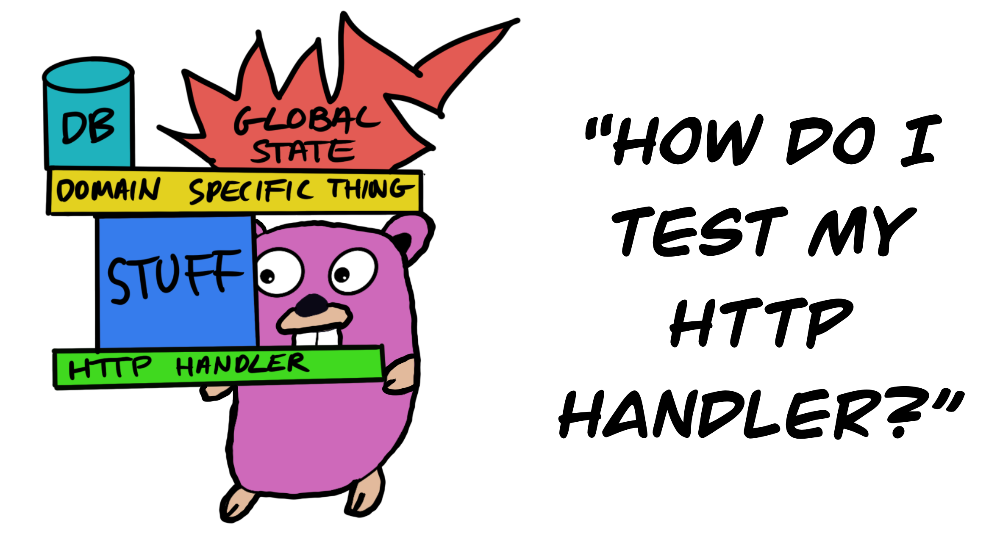

# HTTPハンドラーの再検討

[**この章のすべてのコードはここにあります**](https://github.com/quii/learn-go-with-tests/tree/main/q-and-a/http-handlers-revisited)

このサイトにはすでに[HTTPハンドラーのテスト](../build-an-application/http-server.md) に関する章がありますが、これはそれらの設計に関する幅広い議論を特徴とするため、テストは簡単です。

実際の例を見て、単一責任の原則や懸念の分離などの原則を適用することによって、それがどのように設計されるかを改善する方法を見ていきます。これらの原則は、[インターフェース（interfaces）](../go-fundamentals/structs-methods-and-interfaces.md) and [依存性注入（dependency injection）](../go-fundamentals/dependency-injection.md)を使用して実現できます。これを行うことで、ハンドラーのテストが実際に非常に簡単であることを示します。



HTTPハンドラーのテストはGoコミュニティで繰り返し発生する問題のようです。
私は、HTTPハンドラーの設計方法を誤解している人々のより広い問題を指摘していると思います。

そのため、テストの難しさは、実際にテストを書くことよりも、コードの設計に起因することがよくあります。この本の中で、私はしばしば強調しています。

> テストがあなたを苦しめているなら、そのシグナルに耳を傾け、コードの設計について考えてみてください。

## 例

[Santosh・Kumarがツイートしてくれた](https://twitter.com/sntshk/status/1255559003339284481)

> mongodbに依存するHTTPハンドラをテストするにはどうすればよいですか？

これがコードです

```go
func Registration(w http.ResponseWriter, r *http.Request) {
	var res model.ResponseResult
	var user model.User

	w.Header().Set("Content-Type", "application/json")

	jsonDecoder := json.NewDecoder(r.Body)
	jsonDecoder.DisallowUnknownFields()
	defer r.Body.Close()

	// check if there is proper json body or error
	if err := jsonDecoder.Decode(&user); err != nil {
		res.Error = err.Error()
		// return 400 status codes
		w.WriteHeader(http.StatusBadRequest)
		json.NewEncoder(w).Encode(res)
		return
	}

	// Connect to mongodb
	client, _ := mongo.NewClient(options.Client().ApplyURI("mongodb://127.0.0.1:27017"))
	ctx, _ := context.WithTimeout(context.Background(), 10*time.Second)
	err := client.Connect(ctx)
	if err != nil {
		panic(err)
	}
	defer client.Disconnect(ctx)
	// Check if username already exists in users datastore, if so, 400
	// else insert user right away
	collection := client.Database("test").Collection("users")
	filter := bson.D{{"username", user.Username}}
	var foundUser model.User
	err = collection.FindOne(context.TODO(), filter).Decode(&foundUser)
	if foundUser.Username == user.Username {
		res.Error = UserExists
		// return 400 status codes
		w.WriteHeader(http.StatusBadRequest)
		json.NewEncoder(w).Encode(res)
		return
	}

	pass, err := bcrypt.GenerateFromPassword([]byte(user.Password), bcrypt.DefaultCost)
	if err != nil {
		res.Error = err.Error()
		// return 400 status codes
		w.WriteHeader(http.StatusBadRequest)
		json.NewEncoder(w).Encode(res)
		return
	}
	user.Password = string(pass)

	insertResult, err := collection.InsertOne(context.TODO(), user)
	if err != nil {
		res.Error = err.Error()
		// return 400 status codes
		w.WriteHeader(http.StatusBadRequest)
		json.NewEncoder(w).Encode(res)
		return
	}

	// return 200
	w.WriteHeader(http.StatusOK)
	res.Result = fmt.Sprintf("%s: %s", UserCreated, insertResult.InsertedID)
	json.NewEncoder(w).Encode(res)
	return
}
```

この1つの関数が実行しなければならないすべてのことをリストしましょう。

1. HTTP応答を記述し、ヘッダー、ステータスコードなどを送信します。
2. リクエストの本文を`User`にデコードします。
3. データベースに接続します（およびその周辺のすべての詳細）
4. データベースにクエリを実行し、結果に応じていくつかのビジネスロジックを適用する
5. パスワードを生成する
6. レコードを挿入する

これはやりすぎです。

## HTTPハンドラーとは何ですか？

特定のGoの詳細を一瞬忘れてしまいますが、私が常にうまく機能してきた言語で働いていても、[懸念の分離](https://en.wikipedia.org/wiki/Separation_of_concerns)と[単一責任原則](https://en.wikipedia.org/wiki/Single-responsibility_principle).

これは、あなたが解決しようとしている問題によっては、適用するにはかなり厄介なことになります。責任とは何か？

どれだけ抽象的に考えているかによって線がぼやけてしまうこともありますし、最初の推測が正しいとは限らないこともあります。

ありがたいことに、HTTPハンドラを使うと、どのようなプロジェクトであっても、何をすべきかは大体わかっているような気がします。

1. HTTPリクエストを受け入れ、それを解析して検証する。
2. ステップ1で得たデータを使って`ServiceThing`を呼び出して`ImportantBusinessLogic`を実行する。
3. `ServiceThing`が返す内容に応じて、適切な`HTTP`レスポンスを送信する。

すべてのHTTPハンドラがこのような形をしているべきだと言っているわけではありませんが、私の場合は 100回中99回はこのような形をしているようです。

これらの問題を切り離すと、以下のようになります。

* ハンドラのテストは簡単になり、少数の懸念事項に集中することができます。
* 重要なことは、`ImportantBusinessLogic`をテストする際に、`HTTP`を気にする必要がなくなり、ビジネスロジックをきれいにテストできるようになることです。
* `ImportantBusinessLogic`を変更することなく、他のコンテキストで使用できます。
* `ImportantBusinessLogic`が動作を変更しても、インターフェイスが同じである限り、ハンドラーを変更する必要はありません。

## Go'sのハンドラ

[`http.HandlerFunc`](https://golang.org/pkg/net/http/#HandlerFunc)

> HandlerFunc型は、通常の関数をHTTPハンドラとして利用できるようにするためのアダプタです。

`type HandlerFunc func(ResponseWriter, *Request)`

読者の皆さん、一呼吸おいて上のコードを見てください。何に気がつきましたか？

**いくつかの引数を取る関数です**

フレームワークの魔法もアノテーションも魔法の豆も何もありません。

ただの関数であり、関数のテスト方法は知っています。

これは上の解説とうまく一致しています。

* [`http.Request`](https://golang.org/pkg/net/http/#Request)を取得して、それを検査、解析、検証するためのデータの束にしています。
* > [`http.ResponseWriter`インターフェイスは、HTTPレスポンスを構築するためにHTTPハンドラによって使用されます](https://golang.org/pkg/net/http/#ResponseWriter)

### 超基本的な例題テスト

```go
func Teapot(res http.ResponseWriter, req *http.Request) {
	res.WriteHeader(http.StatusTeapot)
}

func TestTeapotHandler(t *testing.T) {
	req := httptest.NewRequest(http.MethodGet, "/", nil)
	res := httptest.NewRecorder()

	Teapot(res, req)

	if res.Code != http.StatusTeapot {
		t.Errorf("got status %d but wanted %d", res.Code, http.StatusTeapot)
	}
}
```

関数をテストするために、関数を呼び出します。

テストのために`httptest.ResponseRecorder`を`http.ResponseWriter`の引数に渡し、この関数はこれを使って`HTTP`レスポンスを書きます。レコーダーは何が送られてきたかを記録します。

## ハンドラでの`ServiceThing`の呼び出し

TDDチュートリアルについてよくある苦情は、いつも「シンプルすぎて」「現実世界では十分ではない」というものです。それに対する私の答えは次のとおりです。

> あなたが言及している例のように、すべてのコードが読みやすく、テストしやすいものであればいいのではないでしょうか？

これは、私たちが直面している最大の課題の一つですが、努力し続ける必要があります。コードを設計することは可能だし、良いソフトウェア工学の原則を実践して適用すれば、読みやすく、テストしやすいものになるでしょう。

先ほどのハンドラの動作を復習します。

1. HTTPレスポンスを書いて、ヘッダやステータスコードなどを送る。
2. リクエストの本文を`User`にデコードする。
3. データベースに接続する（その辺の細かいことも含めて）
4. データベースに問い合わせ、結果に応じていくつかのビジネスロジックを適用する
5. パスワードを生成する
6. レコードを挿入する

より理想的な懸念の分離のアイデアを取って、私はそれがより多くのようにしたいと思います。

1. リクエストのボディを`User`にデコードする。
2. `UserService.Register(user)`を呼び出します（これは`ServiceThing`）
3. エラーが発生した場合はそれに対処する（例では常に`400 BadRequest`を送信しているが、これは正しいとは思えない）、_今のところ_ は`500 Internal Server Error`のキャッチオールハンドラを用意しておくことにします。すべてのエラーに対して`500`を返すと、ひどいAPIになってしまうことを強調しておかなければなりません。後でエラー処理をもっと洗練させて、おそらく[error types](error-types.md)を使うことができるでしょう。
4. エラーがなければ、`201 Created`のIDをレスポンスボディにします（これもまた簡潔さ／手抜きのためです）

簡潔にするために、通常のTDDプロセスについては説明しません。

### 新しいデザイン

```go
type UserService interface {
	Register(user User) (insertedID string, err error)
}

type UserServer struct {
	service UserService
}

func NewUserServer(service UserService) *UserServer {
	return &UserServer{service: service}
}

func (u *UserServer) RegisterUser(w http.ResponseWriter, r *http.Request) {
	defer r.Body.Close()

	// request parsing and validation
	var newUser User
	err := json.NewDecoder(r.Body).Decode(&newUser)

	if err != nil {
		http.Error(w, fmt.Sprintf("could not decode user payload: %v", err), http.StatusBadRequest)
		return
	}

	// call a service thing to take care of the hard work
	insertedID, err := u.service.Register(newUser)

	// depending on what we get back, respond accordingly
	if err != nil {
		//todo: handle different kinds of errors differently
		http.Error(w, fmt.Sprintf("problem registering new user: %v", err), http.StatusInternalServerError)
		return
	}

	w.WriteHeader(http.StatusCreated)
	fmt.Fprint(w, insertedID)
}
```

この`RegisterUser`メソッドは`http.HandlerFunc`の形と一致しているので、これで問題ない。これを新しいタイプの`UserServer`のメソッドとしてアタッチしていますが、これには`UserService`への依存関係が含まれています。

インターフェースは`HTTP`の問題を特定の実装から切り離すための素晴らしい方法です。
依存関係にあるメソッドを呼び出すだけで、ユーザがどのように登録されるかを気にする必要はありません。

TDDに続いてこのアプローチをより詳しく知りたい場合は、[依存性注入（Dependency Injection）](../go-fundamentals/dependency-injection.md)の章と[HTTPサーバー](../build-an-application/http-server.md)の章を参照してください。

これで、登録に関する特定の実装の詳細から切り離すことができたので、ハンドラのコードを書くのは簡単で、先に説明した責任に従うことになります。

### さぁテストだ！

このシンプルさがテストに反映されています。

```go
type MockUserService struct {
	RegisterFunc    func(user User) (string, error)
	UsersRegistered []User
}

func (m *MockUserService) Register(user User) (insertedID string, err error) {
	m.UsersRegistered = append(m.UsersRegistered, user)
	return m.RegisterFunc(user)
}

func TestRegisterUser(t *testing.T) {
	t.Run("can register valid users", func(t *testing.T) {
		user := User{Name: "CJ"}
		expectedInsertedID := "whatever"

		service := &MockUserService{
			RegisterFunc: func(user User) (string, error) {
				return expectedInsertedID, nil
			},
		}
		server := NewUserServer(service)

		req := httptest.NewRequest(http.MethodGet, "/", userToJSON(user))
		res := httptest.NewRecorder()

		server.RegisterUser(res, req)

		assertStatus(t, res.Code, http.StatusCreated)

		if res.Body.String() != expectedInsertedID {
			t.Errorf("expected body of %q but got %q", res.Body.String(), expectedInsertedID)
		}

		if len(service.UsersRegistered) != 1 {
			t.Fatalf("expected 1 user added but got %d", len(service.UsersRegistered))
		}

		if !reflect.DeepEqual(service.UsersRegistered[0], user) {
			t.Errorf("the user registered %+v was not what was expected %+v", service.UsersRegistered[0], user)
		}
	})

	t.Run("returns 400 bad request if body is not valid user JSON", func(t *testing.T) {
		server := NewUserServer(nil)

		req := httptest.NewRequest(http.MethodGet, "/", strings.NewReader("trouble will find me"))
		res := httptest.NewRecorder()

		server.RegisterUser(res, req)

		assertStatus(t, res.Code, http.StatusBadRequest)
	})

	t.Run("returns a 500 internal server error if the service fails", func(t *testing.T) {
		user := User{Name: "CJ"}

		service := &MockUserService{
			RegisterFunc: func(user User) (string, error) {
				return "", errors.New("couldn't add new user")
			},
		}
		server := NewUserServer(service)

		req := httptest.NewRequest(http.MethodGet, "/", userToJSON(user))
		res := httptest.NewRecorder()

		server.RegisterUser(res, req)

		assertStatus(t, res.Code, http.StatusInternalServerError)
	})
}
```

このハンドラは特定のストレージの実装とは結合されていないので、`MockUserService`を書くことで、シンプルで高速なユニットテストを書くことができます。

### データベースのコードはどうでしょうか? データベースのコードはどうですか?

これはすべて意図的なものです。ビジネスロジックやデータベース、接続などに関係するHTTPハンドラは必要ありません。

このようにすることで、ハンドラを面倒な詳細から解放することができました。
また、無関係なHTTPの詳細に結合されることがなくなるので、永続化レイヤやビジネスロジックのテストがより簡単になりました。

あとは、使いたいデータベースを使って`UserService`を実装するだけです。

```go
type MongoUserService struct {
}

func NewMongoUserService() *MongoUserService {
	//todo: pass in DB URL as argument to this function
	//todo: connect to db, create a connection pool
	return &MongoUserService{}
}

func (m MongoUserService) Register(user User) (insertedID string, err error) {
	// use m.mongoConnection to perform queries
	panic("implement me")
}
```

これを別々にテストして、`main`で満足したら、作業用アプリケーションのためにこの2つのユニットを一緒にスナップすることができます。

```go
func main() {
	mongoService := NewMongoUserService()
	server := NewUserServer(mongoService)
	http.ListenAndServe(":8000", http.HandlerFunc(server.RegisterUser))
}
```

### 少ない労力で、より堅牢で拡張性の高いデザインを実現

これらの原則は、短期的に私たちの生活を楽にするだけでなく、将来的にシステムを拡張しやすくします。

このシステムをさらに改良していくと、登録確認のメールをユーザーに送るようになっても不思議ではありません。

古い設計では、ハンドラとその周辺のテストを変更しなければなりませんでした。これは、コードの一部がメンテナンス不可能になることがよくあることです。

インターフェイスを使って問題を分離することで、登録に関するビジネスロジックには関係ないので、ハンドラを編集する必要は全くありません。

## まとめ

GoのHTTPハンドラのテストは難しくありませんが、優れたソフトウェアの設計は難しくなります。

人々はHTTPハンドラを特別なものだと勘違いして、それを書くときに優れたソフトウェアエンジニアリングのプラクティスを捨ててしまい、テストが難しくなってしまうのです。

もう一度言いますが、**GoのHTTPハンドラは単なる関数**です。
他の関数と同じように、責任を明確にして、懸念事項をしっかりと分離して書けば、テストに問題はなく、コードベースはより健全なものになります。
