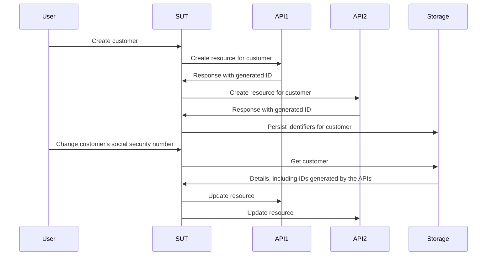

# モック、スタブ、スパイを使わずに開発する

この章では、テストダブルの世界を掘り下げ、それがテストと開発のプロセスにどのような影響を与えるのかを探ります。従来のモック、スタブ、スパイの限界を明らかにし、フェイクとコントラクトを使った、より効率的で適応性の高いアプローチを紹介します。

## tl;dr

- モック、スパイ、スタブは、依存関係の振る舞いについての前提を、各テストの中でその場しのぎ的にコード化することを促します。
- こうした前提は通常、手動での確認以上には検証されないため、テストスイートの有用性を脅かします。
- フェイクとコントラクトは、前提が検証され、他の手法よりも再利用性が高いテストダブルを作るための、より持続可能な方法を与えてくれます。

この章は通常より長いので、気分転換として、まず[サンプルリポジトリ](https://github.com/quii/go-fakes-and-contracts)を見てみるとよいでしょう。特に[plannerのテスト](https://github.com/quii/go-fakes-and-contracts/blob/main/domain/planner/planner_test.go)をチェックしてみてください。

---

[モック](../go-fundamentals/mocking.md)の章では、モック、スタブ、スパイが、[依存性注入](../go-fundamentals/dependency-injection.md)と組み合わせることで、コードのユニットの振る舞いを制御・検査するための便利なツールであることを学びました。

しかし、プロジェクトが大きくなるにつれて、こうした種類のテストダブルは保守の負担に*なりうる*ため、システムを理解しやすく、テストしやすい状態に保つには、別の設計のアイデアに目を向けるべきです。

**フェイク**と**コントラクト**を使うと、開発者はより現実的なシナリオでシステムをテストでき、より速く正確なフィードバックループによってローカルでの開発体験を向上させ、進化していく依存関係の複雑さを管理できます。

### テストダブル入門

私のような人間がテストダブルの用語にこだわるのを見て、うんざりしてしまうのは簡単です。しかし、テストダブルの種類を区別することで、このトピックや私たちが行っているトレードオフについて明確に話せるようになります。

**テストダブル**とは、**テスト対象**（**subject under test**、**SUT**）、つまりテストしているものに対して、制御可能な依存関係を構築するさまざまな方法の総称です。テストダブルは、本物の依存関係を使うよりも優れた選択肢であることが多く、次のような問題を回避できます。

- APIを使うためにインターネット接続が必要になる
- レイテンシなどのパフォーマンスの問題を避ける
- ハッピーパス以外のケースを実行できない
- 自分たちのビルドを他のチームのビルドから切り離す
  - 他のチームのエンジニアがうっかりバグを出荷したせいで、デプロイを止められたくはないでしょう

Goでは通常、依存関係をインターフェースでモデル化し、テストで振る舞いを制御するために独自の実装を作ります。**この章で扱うテストダブルの種類は次のとおりです**。

架空のレシピAPIの次のようなインターフェースがあるとします。

```go
type RecipeBook interface {
	GetRecipes() ([]Recipe, error)
	AddRecipes(...Recipe) error
}
```

`RecipeBook`を使う何かをどのようにテストしようとしているかに応じて、さまざまな方法でテストダブルを構築できます。

**スタブ**は、呼び出されるたびに同じ決まったデータを返します。

```go
type StubRecipeStore struct {
	recipes []Recipe
	err     error
}

func (s *StubRecipeStore) GetRecipes() ([]Recipe, error) {
	return s.recipes, s.err
}

// AddRecipes omitted for brevity
```

```go
// in test, we can set up the stub to always return specific recipes, or an error
stubStore := &StubRecipeStore{
	recipes: someRecipes,
}
```

**スパイ**はスタブに似ていますが、どのように呼び出されたかも記録するので、テストはSUTが依存関係を特定の方法で呼び出していることをアサートできます。

```go
type SpyRecipeStore struct {
	AddCalls [][]Recipe
	err      error
}

func (s *SpyRecipeStore) AddRecipes(r ...Recipe) error {
	s.AddCalls = append(s.AddCalls, r)
	return s.err
}

// GetRecipes omitted for brevity
```

```go
// in test
spyStore := &SpyRecipeStore{}
sut := NewThing(spyStore)
sut.DoStuff()

// now we can check the store had the right recipes added by inspectiong spyStore.AddCalls
```

**モック**は上記のスーパーセットのようなものですが、特定の呼び出しに対してのみ特定のデータで応答します。SUTが間違った引数で依存関係を呼び出すと、通常はパニックします。

```go
// set up the mock with expected calls
mockStore := &MockRecipeStore{}
mockStore.WhenCalledWith(someRecipes).Return(someError)

// when the sut uses the dependency, if it doesn't call it with someRecipes, usually mocks will panic
```

**フェイク**は依存関係の本物のバージョンのようなものですが、高速に実行できる信頼性の高いテストやローカル開発に適した方法で実装されています。システムには永続化に関する何らかの抽象化があり、それはデータベースで実装されていることが多いですが、テストでは代わりにインメモリのフェイクを使うことができます。

```go
type FakeRecipeStore struct {
	recipes []Recipe
}

func (f *FakeRecipeStore) GetRecipes() ([]Recipe, error) {
	return f.recipes, nil
}

func (f *FakeRecipeStore) AddRecipes(r ...Recipe) error {
	f.recipes = append(f.recipes, r...)
	return nil
}
```

フェイクが便利な理由は次のとおりです。

- 状態を持つ性質は、統合テストのように複数の対象や呼び出しを含むテストに役立ちます。他の種類のテストダブルで状態を管理することは、一般的に推奨されません。
- 適切なAPIを持っていれば、より自然な方法で状態をアサートできます。依存関係への特定の呼び出しをスパイするのではなく、最終的な状態を問い合わせて、望んだ実際の効果が起きたかどうかを確認できます。
- 本物の依存関係を立ち上げたり、それに依存したりすることなく、アプリケーションをローカルで実行するのに使えます。フェイクは本物よりも速く信頼性が高いので、通常は開発者体験（DX）が向上します。

スパイ、モック、スタブは通常、ツールやリフレクションを使ってインターフェースから自動生成できます。しかし、フェイクはダブルを作ろうとしている依存関係の振る舞いをコード化するものなので、少なくとも実装の大部分は自分で書かなければなりません。

## スタブとモックの問題点

[アンチパターン](../meta/anti-patterns.md)の章では、テストダブルの使用には注意が必要であることを詳しく説明しています。センスよく使わなければ、テストスイートはすぐに散らかってしまいます。しかし、プロジェクトが大きくなると、別の問題も忍び寄ってきます。

テストダブルに振る舞いをコード化するとき、あなたは本物の依存関係がどのように動くかについての前提をテストに加えています。ダブルと本物の依存関係の振る舞いに食い違いがある場合、あるいは時間とともに食い違いが生じた場合（たとえば本物の依存関係が変わる場合。これは想定して*おかなければならない*ことです）、**テストは成功しているのにソフトウェアは壊れている**という状態になるかもしれません。

スタブ、スパイ、モックには、特にプロジェクトが大きくなるにつれて、別の課題もあります。これを説明するために、私が携わったプロジェクトについて紹介します。

### ケーススタディ

*実際に起きたこととは一部の詳細を変えてあり、簡潔さのために大幅に単純化しています。**実在の人物との類似は、生死を問わず、まったくの偶然です。***

私が携わったシステムは、世界中の他のチームが書いて保守している**6つ**の異なるAPIを呼び出す必要がありました。それらは _REST風_ のAPIで、私たちのシステムの仕事は、それらすべての中でリソースを作成・管理することでした。各システムのAPIをすべて正しく呼び出すと、_魔法_（ビジネス価値）が起きるのです。

私たちのアプリケーションは、ヘキサゴナル / ポートとアダプターのアーキテクチャで構成されていました。ドメインのコードは、私たちが対処しなければならない外の世界の混乱から切り離されていました。「アダプター」は、実質的にはさまざまなAPIの呼び出しをカプセル化したGoのクライアントでした。


#### トラブル

当然、私たちはテスト駆動のアプローチでシステムを構築しました。スタブを活用して下流のAPIのレスポンスをシミュレートし、すべてがうまく動くはずだと安心するための受け入れテストもいくつか用意しました。

しかし、私たちが呼び出さなければならなかったAPIの大部分は、次のようなものでした。

- ドキュメントが不十分
- 他に相反する優先事項やプレッシャーを多く抱えたチームによって運用されていて、彼らと時間を取るのが容易ではない
- テストカバレッジが不足していることが多く、面白いほど予想外の形で壊れたり、リグレッションを起こしたりする
- まだ開発中で、進化し続けている

その結果、**大量の不安定なテスト（flaky test）**と多くの頭痛の種が生まれました。私たちの時間の _かなりの部分_ が、Slackで多くの忙しい人たちに連絡し、次のような質問の答えを得ようとすることに費やされました。

- なぜAPIは`x`をするようになったのか？
- なぜ`y`をするとAPIは違うことをするのか？

ソフトウェア開発が期待どおりに単純であることはめったになく、それは学習の営みです。私たちは外部APIがどのように動くのかを継続的に学ばなければなりませんでした。学び、適応するにつれて、テストスイートを更新したり追加したりする必要があり、特に**スタブをAPIの実際の振る舞いに合わせて変更する**必要がありました。

問題は、これに多くの時間を取られ、さらなるミスにつながったことです。依存関係についての知識が変わったとき、スタブの振る舞いを変えるために更新すべき**正しい**テストを見つけなければならず、同じ依存関係を表している他のスタブの更新を怠ってしまうという現実的なリスクがあります。

#### テスト戦略

それに加えて、システムが成長し要件が変わっていく中で、私たちはテスト戦略が適切でないことに気づきました。システム全体が動くという自信を与えてくれる受け入れテストがいくつかあり、そして書いたさまざまなパッケージに対する大量のユニットテストがありました。

<u>私たちにはその中間のものが必要でした</u>。システムのさまざまな部分の振る舞いを一緒に変えたいことがよくありましたが、**受け入れテストのために*システム全体*を立ち上げる必要はない**ようにしたかったのです。ユニットテストだけでは、さまざまなコンポーネントが全体として動くという自信は得られませんでした。ユニットテストは、私たちが達成しようとしていることのストーリーを伝える（そして検証する）ことができませんでした。**私たちは統合テストを求めていたのです**。

#### 統合テスト

統合テストは、2つ以上の「ユニット」が組み合わされた（あるいは統合された！）ときに正しく動くことを証明します。これらのユニットは、あなたが書いたコードの場合もあれば、あなたが書いたコードとデータベースのような他の誰かのコードを統合したものの場合もあります。

プロジェクトが大きくなるにつれて、システムの大きな部分が「うまくまとまっている」、つまり統合されていることを証明するために、より多くの統合テストを書きたくなります。

ブラックボックスの受け入れテストをもっと書きたくなるかもしれませんが、それはビルド時間や保守コストの面ですぐに高くつくようになります。システムの*一部*（ただし単一のユニットではない）が想定どおりに振る舞うかを確認したいだけなのに、システム全体を立ち上げるのはコストが高すぎることがあります。すべての機能に対して高コストなブラックボックステストを書くことは、大きなシステムでは持続可能ではありません。

#### 登場：フェイク

問題は、ユニットのテスト方法がスタブに依存していたことでした。スタブはほとんどの場合*状態を持ちません*。私たちは、最初にリソースを作成し、後でそれを編集するような、複数の*状態を持つ*API呼び出しをカバーするテストを書きたかったのです。

以下は、私たちがやりたいテストを簡略化したものです。

SUTは「ユースケース」のリクエストを扱う「サービス層」です。顧客が作成された後、その詳細が変更されたときに、それぞれのAPIで作成したリソースを正しく更新できることを証明したいのです。

以下は、ユーザーストーリーとしてチームに与えられた要件です。

> ***Given*** ユーザーがAPI 1、2、3に登録されている
>
> ***When*** 顧客の社会保障番号が変更される
>
> ***Then**、* その変更がAPI 1、2、3に伝播される



複数のユニットにまたがるテストは、通常スタブとは相性がよくありません。**スタブは状態を保持するのに向いていないからです**。ブラックボックスの受け入れテストを書くことも _できます_ が、そうしたテストのコストはすぐに手に負えなくなるでしょう。

さらに、ブラックボックステストでは依存関係を制御できないため、エッジケースをテストするのが複雑になります。たとえば、私たちはあるAPI呼び出しが失敗したときにロールバックの仕組みが発動することを証明したいと考えていました。

私たちには**フェイク**が必要でした。依存関係を、インメモリのフェイクを使って状態を持つAPIとしてモデル化することで、はるかに広い範囲の統合テストを書けるようになり、**実際のユースケースが動くことをテストできる**ようになりました。しかもここでも、システム全体を立ち上げる*ことなく*、ユニットテストとほぼ同じ速度で実行できたのです。


フェイクを使うと、**複雑なスパイに頼るのではなく、それぞれのシステムの最終的な状態に基づいてアサーションを行えます**。各フェイクに、その顧客についてどんなレコードを保持しているかを問い合わせ、それらが更新されたことをアサートするのです。このほうが自然に感じられます。手動でシステムを確認するなら、特定のJSONペイロードを送ったかどうかをリクエストログで調べるのではなく、それらのAPIに問い合わせて状態を確認するはずだからです。

```go
// take our lego-bricks and assemble the system for the test
fakeAPI1 := fakes.NewAPI1()
fakeAPI2 := fakes.NewAPI2() // etc..
customerService := customer.NewService(fakeAPI1, fakeAPI2, etc...)

// create new customer
newCustomerRequest := NewCustomerReq{
	// ...
}
createdCustomer, err := customerService.New(newCustomerRequest)
assert.NoErr(t, err)

// we can verify all the details are as expected in the various fakes in a natural way, as if they're normal APIs
fakeAPI1Customer := fakeAPI1.Get(createdCustomer.FakeAPI1Details.ID)
assert.Equal(t, fakeAPI1Customer.SocialSecurityNumber, newCustomerRequest.SocialSecurityNumber)

// repeat for the other apis we care about

// update customer
updatedCustomerRequest := NewUpdateReq{SocialSecurityNumber: "123", InternalID: createdCustomer.InternalID}
assert.NoErr(t, customerService.Update(updatedCustomerRequest))

// again we can check the various fakes to see if the state ends up how we want it
updatedFakeAPICustomer := fakeAPI1.Get(createdCustomer.FakeAPI1Details.ID)
assert.Equal(t, updatedFakeAPICustomer.SocialSecurityNumber, updatedCustomerRequest.SocialSecurityNumber)
```

これは、スパイを通じて行われたさまざまな関数呼び出しの引数を確認するよりも、書くのが簡単で読みやすいです。

このアプローチによって、システムの広い範囲にまたがるテストを持てるようになり、スタンドアップで話し合うようなユースケースについての、より**意味のある**テストを書きながら、非常に高速に実行し続けることができます。

#### フェイクはカプセル化の利点をより多くもたらす

上の例では、テストは依存関係の最終状態を検証すること以上に、依存関係がどう振る舞うかを気にしていませんでした。依存関係のフェイク版を作成し、テストしているシステムの部分に注入しただけです。

モックやスタブの場合、各依存関係が特定のシナリオを処理し、特定のデータを返すようにセットアップしなければなりません。これは振る舞いや実装の詳細をテストに持ち込み、カプセル化の利点を弱めてしまいます。

私たちが依存関係をインターフェースの背後にモデル化するのは、クライアントとして _それがどう動くかを気にしなくて済む_ ようにするためです。しかし「モック主義（mockist）」のアプローチでは、_**すべてのテストで**気にしなければならない_ のです。

#### フェイクの保守コスト

フェイクは、少なくとも書くコードの量という点では、他のテストダブルよりもコストがかかります。状態を持ち、フェイクしている対象の振る舞いをシミュレートしなければならないからです。フェイクと本物の振る舞いの食い違いは、テストが現実と一致していない**リスクを伴います**。これは、テストは成功しているのにソフトウェアが壊れているというシナリオにつながります。

他のチームのAPIであれデータベースであれ、他のシステムと統合するときはいつでも、その振る舞いに基づいた前提を置くことになります。その前提は、APIドキュメント、直接の会話、メール、Slackのスレッドなどから得られたものかもしれません。

もし**前提をコード化**して、フェイク*と*本物のシステムの両方に対して実行し、自分たちの知識が正しいかどうかを再現可能かつ文書化された形で確認できたら、役に立つと思いませんか？

そのための手段が**コントラクト**です。コントラクトは、他のチームのシステムについて私たちが置いた前提を管理し、明示的にするのに役立ちました。メールのやり取りや終わりのないSlackのスレッドよりも、はるかに明示的で有用です！


コントラクトがあれば、フェイクと本物の依存関係を入れ替えて使えると想定できます。これはテストを構築するのに役立つだけでなく、ローカル開発にも役立ちます。

以下は、システムが依存しているAPIの1つに対するコントラクトの例です。

```go
type API1Customer struct {
	Name string
	ID   string
}

type API1 interface {
	CreateCustomer(ctx context.Context, name string) (API1Customer, error)
	GetCustomer(ctx context.Context, id string) (API1Customer, error)
	UpdateCustomer(ctx context.Context, id string, name string) error
}

type API1Contract struct {
	NewAPI1 func() API1
}

func (c API1Contract) Test(t *testing.T) {
	t.Run("can create, get and update a customer", func(t *testing.T) {
		var (
			ctx  = context.Background()
			sut  = c.NewAPI1()
			name = "Bob"
		)

		customer, err := sut.CreateCustomer(ctx, name)
		expect.NoErr(t, err)

		got, err := sut.GetCustomer(ctx, customer.ID)
		expect.NoErr(t, err)
		expect.Equal(t, customer, got)

		newName := "Robert"
		expect.NoErr(t, sut.UpdateCustomer(ctx, customer.ID, newName))

		got, err = sut.GetCustomer(ctx, customer.ID)
		expect.NoErr(t, err)
		expect.Equal(t, newName, got.Name)
	})

	// example of strange behaviours we didn't expect
	t.Run("the system will not allow you to add 'Dave' as a customer", func(t *testing.T) {
		var (
			ctx  = context.Background()
			sut  = c.NewAPI1()
			name = "Dave"
		)

		_, err := sut.CreateCustomer(ctx, name)
		expect.Err(t, ErrDaveIsForbidden)
	})
}
```

[受け入れテストのスケーリング](scaling-acceptance-tests.md)の章で説明したように、具体的な型ではなくインターフェースに対してテストすることで、テストは次のようになります。

- 実装の詳細から切り離される
- さまざまなコンテキストで再利用できる

これらがコントラクトの要件です。コントラクトによって、フェイクを検証しながら開発し、_さらに_ 本物の実装に対してもテストできます。

インメモリのフェイクを作るには、テストの中でコントラクトを使います。

```go
func TestInMemoryAPI1(t *testing.T) {
	API1Contract{NewAPI1: func() API1 {
		return inmemory.NewAPI1()
	}}.Test(t)
}
```

そして、これがフェイクのコードです。

```go
func NewAPI1() *API1 {
	return &API1{customers: make(map[string]planner.API1Customer)}
}

type API1 struct {
	i         int
	customers map[string]planner.API1Customer
}

func (a *API1) CreateCustomer(ctx context.Context, name string) (planner.API1Customer, error) {
	if name == "Dave" {
		return planner.API1Customer{}, ErrDaveIsForbidden
	}

	newCustomer := planner.API1Customer{
		Name: name,
		ID:   strconv.Itoa(a.i),
	}
	a.customers[newCustomer.ID] = newCustomer
	a.i++
	return newCustomer, nil
}

func (a *API1) GetCustomer(ctx context.Context, id string) (planner.API1Customer, error) {
	return a.customers[id], nil
}

func (a *API1) UpdateCustomer(ctx context.Context, id string, name string) error {
	customer := a.customers[id]
	customer.Name = name
	a.customers[id] = customer
	return nil
}
```

### 進化するソフトウェア

ほとんどのソフトウェアは、1回のリリースで構築されて永遠に「完成」するものではありません。

それは顧客の要求やその他の外部の変化に適応していく、段階的な学習の営みです。この例では、私たちが呼び出していたAPIも進化し変化していました。さらに、_私たちの_ ソフトウェアを開発するにつれて、_本当に_ 作る必要があるシステムについてより多くを学びました。コントラクトで置いた前提が間違っていたことが判明したり、間違いに _なった_ りしました。

ありがたいことに、コントラクトのセットアップができてしまえば、変化に対処するシンプルな方法がありました。バグ修正の結果として、あるいは同僚からAPIが変わると知らされて、何か新しいことを学んだら、私たちは次のようにしました。

1. 新しいシナリオを実行するテストを書く。この中には、フェイクで振る舞いをシミュレートするよう**駆動する**ためにコントラクトを変更することも含まれます
2. テストを実行すると失敗するはずですが、何よりも先に、コントラクトへの変更が妥当であることを確認するために、本物の依存関係に対してコントラクトを実行します。
3. コントラクトに適合するようにフェイクを更新する。
4. テストを成功させる。
5. リファクタリングする。
6. すべてのテストを実行して出荷する。

チェックインする前に _すべての_ テストスイートを実行すると、フェイクの振る舞いが変わったことで他のテストが失敗する _かもしれません_。これは**良いこと**です！ 変更されたシステムに依存しているシステムの他の部分をすべて修正でき、それらも本番環境でこのシナリオを処理できると確信できます。このアプローチがなければ、関連するテストをすべて見つけてスタブを更新することを*覚えておかなければ*なりません。ミスが起きやすく、骨が折れ、退屈な作業です。

### 優れた開発者体験

対応するコントラクトを持つフェイクのスイートを手にしたことは、まるで超能力を得たかのようでした。ついに、対処しなければならないAPIの複雑さを手なずけることができたのです。

さまざまなシナリオのテストを書くのがずっと簡単になりました。もはやテストのたびに一連のスタブやスパイを組み立てる必要はなく、ユニットやモジュールのセット（フェイクや私たち自身の「サービス」）を手に取り、必要なさまざまな奇妙で素晴らしいシナリオを実行するために、それらをとても簡単に組み立てることができました。

スタブ、スパイ、モックを使うテストはすべて、その場しのぎのセットアップのせいで、外部システムがどう振る舞うかを _気にしなければ_ なりません。一方、フェイクは他のよくカプセル化されたコードのユニットと同じように扱えます。詳細は隠されていて、ただ使えばよいのです。

非常に現実に近いバージョンのシステムをローカルで実行でき、すべてがインメモリだったので、起動も実行も非常に高速でした。つまりテスト時間がとても短く、スイートの網羅性を考えると非常に印象的でした。

ステージング環境で受け入れテストが失敗した場合、最初のステップは、依存しているAPIに対してコントラクトを実行することでした。私たちはしばしば、**他のシステムの開発者よりも先に**問題を特定できました。

### デコレーターでハッピーパスから外れる

エラーシナリオについては、テストの中でスタブが*どのように*振る舞うかに直接アクセスできるため、スタブのほうが便利です。一方、フェイクはかなりブラックボックス的になりがちです。これは意図的な設計上の選択です。フェイクを使う側（たとえばテスト）には、それがどう動くかを気にしてほしくないのです。コントラクトの裏付けがあるので、フェイクが正しいことをすると信頼すべきです。

では、ハッピーパス以外の関心事を実行するために、フェイクを失敗させるにはどうすればよいのでしょうか？

開発者として、ソースを変更せずにコードの振る舞いを変更する必要があるシナリオはたくさんあります。**デコレーターパターン**は、コードのユニットにロギング、テレメトリ、リトライなどを追加するためによく使われる方法です。必要に応じて振る舞いを上書きするために、これを使ってフェイクをラップできます。

`API1`の例に戻ると、必要なインターフェースを実装し、フェイクをラップする型を作れます。

```go
type API1Decorator struct {
	delegate           API1
	CreateCustomerFunc func(ctx context.Context, name string) (API1Customer, error)
	GetCustomerFunc    func(ctx context.Context, id string) (API1Customer, error)
	UpdateCustomerFunc func(ctx context.Context, id string, name string) error
}

// assert API1Decorator implements API1
var _ API1 = &API1Decorator{}

func NewAPI1Decorator(delegate API1) *API1Decorator {
	return &API1Decorator{delegate: delegate}
}

func (a *API1Decorator) CreateCustomer(ctx context.Context, name string) (API1Customer, error) {
	if a.CreateCustomerFunc != nil {
		return a.CreateCustomerFunc(ctx, name)
	}
	return a.delegate.CreateCustomer(ctx, name)
}

func (a *API1Decorator) GetCustomer(ctx context.Context, id string) (API1Customer, error) {
	if a.GetCustomerFunc != nil {
		return a.GetCustomerFunc(ctx, id)
	}
	return a.delegate.GetCustomer(ctx, id)
}

func (a *API1Decorator) UpdateCustomer(ctx context.Context, id string, name string) error {
	if a.UpdateCustomerFunc != nil {
		return a.UpdateCustomerFunc(ctx, id, name)
	}
	return a.delegate.UpdateCustomer(ctx, id, name)
}
```

テストでは、スタブ、スパイ、モックと同じように、`XXXFunc`フィールドを使ってテストダブルの振る舞いを変更できます。

```go
failingAPI1 = NewAPI1Decorator(inmemory.NewAPI1())
failingAPI1.UpdateCustomerFunc = func(ctx context.Context, id string, name string) error {
	return errors.New("failed to update customer")
}
```

しかし、これは確かに _扱いにくく_、ある程度の判断が求められます。このアプローチでは、テストの中でフェイクにその場しのぎの振る舞いを持ち込むことになるので、コントラクトによる保証を失ってしまいます。

自分の状況をよく検討するのが一番です。特定のアンハッピーパスについては、スタブを使ってユニットテストのレベルでテストしたほうがシンプルだという結論になるかもしれません。

### この追加のコードは無駄ではないのか？

顧客に役立つコードだけを書くべきで、それでいて効率的に積み上げていけるシステムを期待するというのは、希望的観測にすぎません。人々は無駄とは何かについて、非常に歪んだ考えを持っています（私の記事を参照してください：[The ghost of Henry Ford is ruining your development team](https://quii.dev/The_ghost_of_Henry_Ford_is_ruining_your_development_team)）。

自動テストは直接顧客の利益になるわけではありませんが、私たちは自分たちの仕事をより効率的にするためにテストを書きます（カバレッジのスコアを追いかけるためにテストを書いているわけではありませんよね？）。

エンジニアは、問題をデバッグ、テスト、修正するために、（その場しのぎではなく再現可能な方法で）シナリオを簡単にシミュレートできなければなりません。**インメモリのフェイクと優れたモジュール設計により、シナリオに関係するアクターを分離し、高速で適切なテストを非常に安価に書くことができます**。この柔軟性により、開発者は、書くのも実行するのも高コストなブラックボックステストや、さらに悪いことに共有環境での手動テストでテストされている、もつれた混乱状態のシステムよりも、はるかに扱いやすくシステムを反復的に改善できます。

これは[シンプルさと容易さ（simple vs. easy）](https://www.youtube.com/watch?v=SxdOUGdseq4)の一例です。もちろん、短期的にはフェイクとコントラクトはスタブやスパイよりも多くのコードを書くことになりますが、長期的にはより単純で保守コストの低いシステムになります。スパイ、スタブ、モックを少しずつ更新していくのは労力がかかり、ミスも起きやすいです。テストダブルが正しく振る舞うことを確認する対応するコントラクトがないからです。

このアプローチは、初期コストが _わずかに_ 増えますが、コントラクトとフェイクがセットアップされてしまえば、その後のコストははるかに低くなります。フェイクは、スタブのようなその場しのぎのテストダブルよりも再利用性が高く、信頼性も高いのです。

新しいテストを書くときに、スタブをセットアップするのではなく、既存の実戦で鍛えられたフェイクを使うことは、*とても*解放的で、**自信**を与えてくれます。

### これはTDDにどう適合するのか？

コントラクトから _始める_ ことはお勧めしません。それはボトムアップの設計であり、一般的に私はそのためにはより賢くなる必要があると感じますし、仮定の要件について考えすぎてしまう危険があります。

このテクニックは、前の章や[The Why of TDD](https://quii.dev/The_Why_of_TDD)、そして[GOOS](http://www.growing-object-oriented-software.com)で説明されている「受け入れテスト駆動のアプローチ」と相性がよいです。

- 失敗する[受け入れテスト](scaling-acceptance-tests.md)を書く。
- それを成功させるのに十分なコードを駆動して書き出す。通常は、API、データベースなどに依存する何らかの「サービス層」ができあがります。通常、ビジネスロジックのコードは、インターフェースを介して外部の関心事（永続化、データベースの呼び出しなど）から切り離されています。
- まずはインメモリのフェイクでインターフェースを実装し、ローカルですべてのテストを成功させ、初期の設計を検証する。
- 本番環境にプッシュするには、インメモリは使えません！フェイクに対して置いた前提を、コントラクトにコード化する。
- コントラクトを使って、ストアのMySQL版のような本物の依存関係を作る。
- 出荷する。

## データベースのテストに関する章はどこにあるのか？

これは5年以上も先延ばしにしてきた、よくあるリクエストです。その理由は、この章が常に私の答えになるからです。

<u>データベースドライバーをモックして呼び出しをスパイしないでください</u>。そうしたテストは書くのが難しく、もたらす価値もごくわずかになりがちです。特定の`SQL`文がデータベースに送られたかどうかをアサートすべきではありません。それは実装の詳細です。**テストは振る舞いだけを気にするべきです**。特定のSQL文が組み立てられたことを証明しても、コードが必要なとおりに _振る舞う_ ことの証明には _なりません_。

**コントラクト**は、テストを実装の詳細から切り離し、振る舞いに集中することを強制します。

上で説明したTDDのアプローチに従って、永続化のニーズを駆動して書き出してください。

[サンプルリポジトリ](https://github.com/quii/go-fakes-and-contracts)には、コントラクトの例と、それらを使っていくつかの永続化ニーズのインメモリ実装とSQLite実装をテストする方法の例があります。

```go
package inmemory_test

import (
	"github.com/quii/go-fakes-and-contracts/adapters/driven/persistence/inmemory"
	"github.com/quii/go-fakes-and-contracts/domain/planner"
	"testing"
)

func TestInMemoryPantry(t *testing.T) {
	planner.PantryContract{
		NewPantry: func() planner.Pantry {
			return inmemory.NewPantry()
		},
	}.Test(t)
}
```

```go
package sqlite_test

import (
	"github.com/quii/go-fakes-and-contracts/adapters/driven/persistence/sqlite"
	"github.com/quii/go-fakes-and-contracts/domain/planner"
	"testing"
)

func TestSQLitePantry(t *testing.T) {
	client := sqlite.NewSQLiteClient()
	t.Cleanup(func() {
		if err := client.Close(); err != nil {
			t.Error(err)
		}
	})

	planner.PantryContract{
		NewPantry: func() planner.Pantry {
			return sqlite.NewPantry(client)
		},
	}.Test(t)
}
```

Dockerなどのおかげでデータベースをローカルで実行するのは _確かに_ 簡単になりましたが、それでもかなりのパフォーマンスのオーバーヘッドを伴うことがあります。コントラクト付きのフェイクを使えば、「重い」依存関係を使う必要があるのはコントラクトを検証するときだけに限定でき、他の種類のテストでは不要になります。

システムの*残りの部分*の受け入れテストや統合テストにインメモリのフェイクを使うことで、はるかに高速でシンプルな開発者体験が得られます。

## まとめ

ソフトウェアプロジェクトでは、共通の目標に到達するために、さまざまなチームが並行してシステムを構築するよう組織されることがよくあります。

この働き方には、高度な協力とコミュニケーションが必要です。多くの人は「APIファースト」のアプローチなら、いくつかのAPIコントラクトを（たいていはWikiページに！）定義し、その後6か月間独立して作業して、最後にすべてをくっつければよいと考えています。しかし、これが実際にうまくいくことはめったにありません。コードを書き始めると、ドメインや問題をよりよく理解するようになり、それが私たちの前提に疑問を投げかけるからです。私たちはこうした知識の変化に対応しなければならず、それにはしばしばチームをまたいだ変更が必要になります。

ですから、もしあなたがこうした状況にいるなら、作業しているシステムの内側と外側の両方で起きる予測不可能な変化に対処できるよう、システムを最適な形で構成しテストする必要があります。

> 「ソフトウェア開発における高パフォーマンスなチームを特徴づけるものの1つは、自分たちの小さなチームの外にいる人やグループに許可を求めることなく、前進し、考えを変えることができる能力である。」
>
> Modern Software Engineering
> David Farley

変更を具体化するのに、週次の会議やSlackのスレッドに頼らないでください。**前提をコントラクトにコード化しましょう**。そのコントラクトをビルドパイプラインの中でシステムに対して実行すれば、新しい情報が明らかになったときに素早いフィードバックが得られます。こうしたコントラクトと**フェイク**を組み合わせることで、独立して作業し、外部の変化を持続可能な形で管理できるようになります。

### モジュールの集合としてのシステム

Farleyの本に話を戻すと、私が説明しているのは**インクリメンタリズム（漸進主義）**という考え方です。ソフトウェアを構築することは*絶え間ない学習の営み*です。あるシステムが価値を提供するために解決しなければならない要件を、前もってすべて理解するのは非現実的です。だからこそ、**素早くフィードバックを集めて実験する**ためにシステムや働き方を最適化しなければならないのです。

この章で説明したアイデアを活用するには、**モジュール化されたシステム**が必要です。信頼できるフェイクを備えたモジュール化されたコードがあれば、自動テストを使って安価にシステムを実験できます。

私たちは、奇妙で仮定的な（しかし起こりうる）シナリオを自己完結したテストに変換するのが非常に簡単であることに気づきました。モジュールを組み合わせ、異なるデータを異なる順序で試し、いくつかのAPIを失敗させるなどして、問題を理解し、より堅牢なソフトウェアを駆動して作り出すことができたのです。

よく定義され、よくテストされたモジュールがあれば、_すべて_ を一度に変更したり理解したりすることなく、システムを少しずつ成長させることができます。

### でも、私は安定したAPIを使った小さなものに取り組んでいるだけです

安定したAPIであっても、開発者体験やビルドなどが他の人のコードに密結合してしまうのは望ましくありません。このアプローチを正しく実践すれば、本番環境のためにシステムを組み立てたり、ローカルで実行したり、信頼できるダブルを使ってさまざまな種類のテストを書いたりするための、組み合わせ可能なモジュールのセットが手に入ります。

これにより、関心のあるシステムの部分を分離し、解決しようとしている本当の問題についての意味のあるテストを書くことができます。

### 依存関係を第一級市民にしよう

もちろん、スタブやスパイにも出番はあります。テストの中でその場しのぎ的に依存関係のさまざまな振る舞いをシミュレートすることには常に用途がありますが、コストが手に負えなくならないよう注意してください。

私はキャリアの中で何度も、才能ある開発者が丁寧に書いたソフトウェアが、統合の問題のせいで崩壊するのを見てきました。統合がエンジニアにとって難しいのは、他のエンジニアが書き、しかも同時に変更し続けているシステムの振る舞いを正確に再現するのが難しい _からです_。

全員が共有環境にデプロイし、そこでテストすることに頼っているチームもあります。問題は、これでは**分離された**フィードバックが得られず、**フィードバックが遅い**ことです。また、自分のシステムが他の依存関係とどう連携するかについて、さまざまな実験を組み立てることも、少なくとも効率的にはできません。

本番環境に到達する前に開発マシン上で素早くテストや実験ができるよう、**依存関係をモデル化するより洗練された方法を採用して、この複雑さを手なずけなければなりません**。コントラクトによって検証された、現実的で管理しやすい依存関係のフェイクを作りましょう。そうすれば、より意味のあるテストを書き、システムで実験できるようになり、成功の可能性が高まります。
